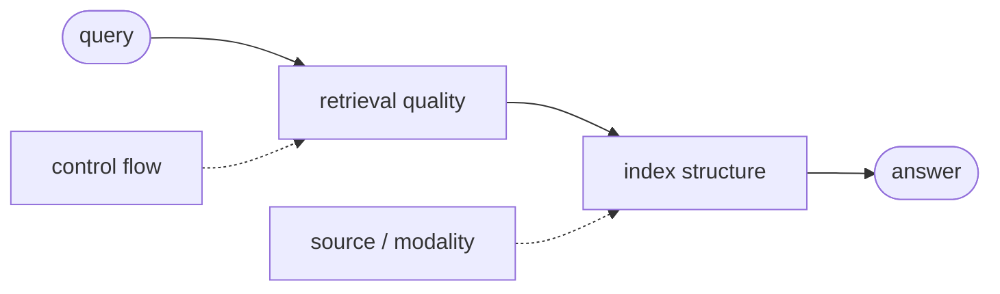
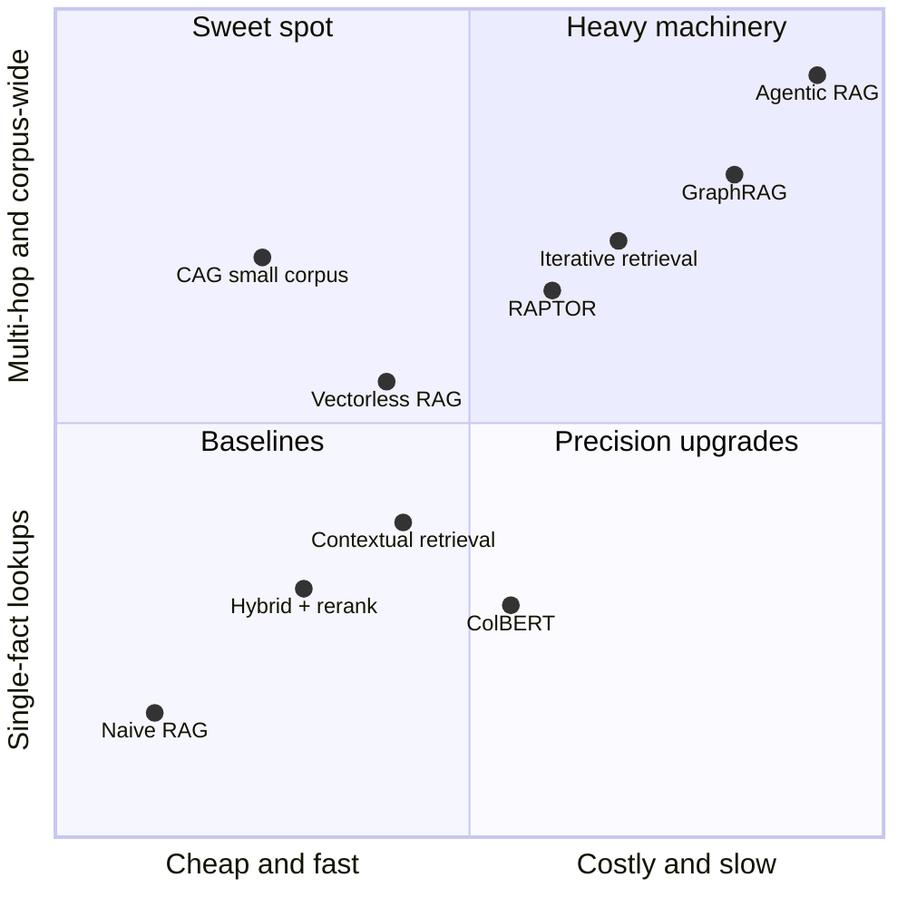
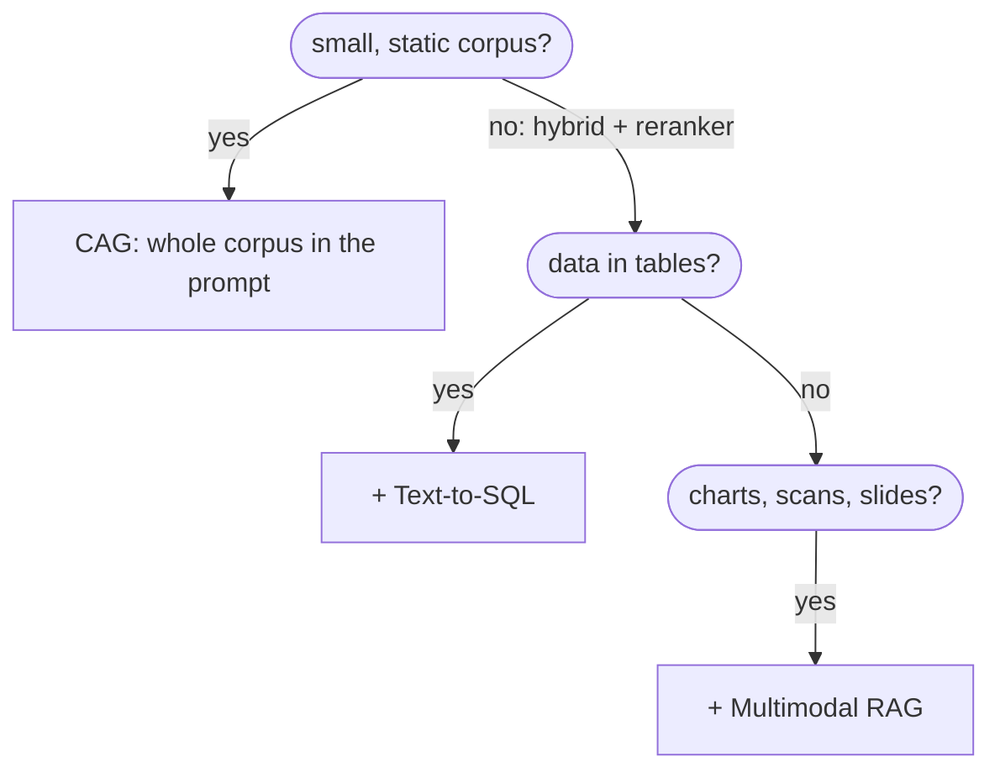
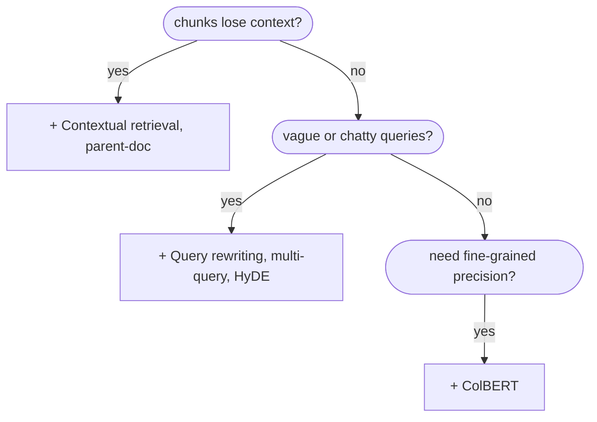
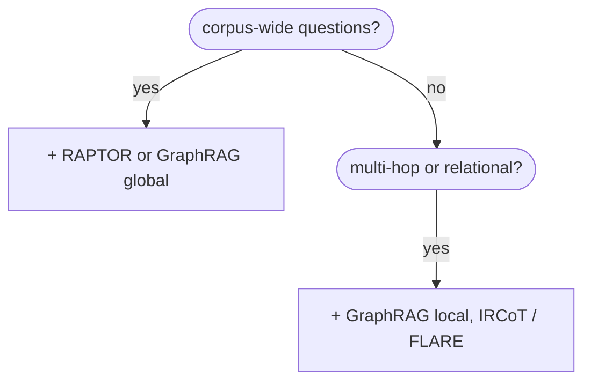
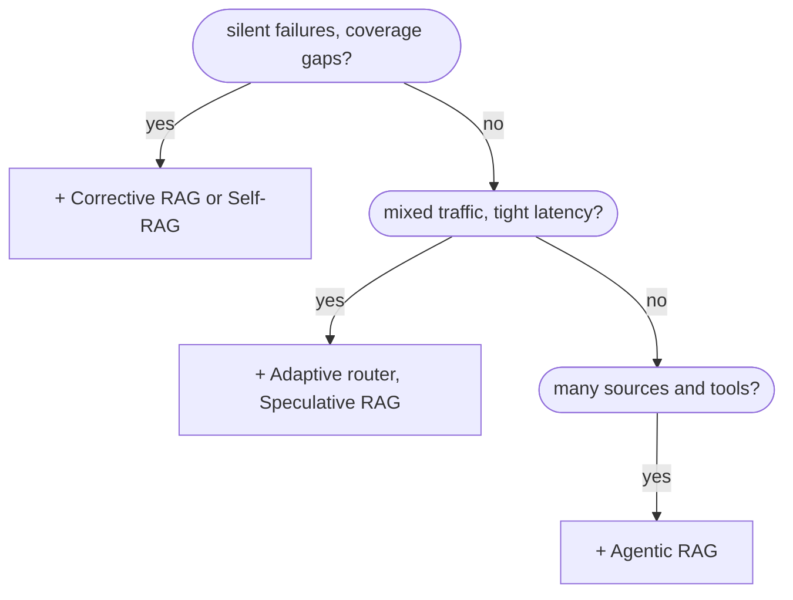

# RAG map

Entry point to the knowledge base. Every RAG variant has a note under `notes/variants/<family>/`. Code stays in the repo (`rag/`, `examples/`, `app/`), and notes link to it. The `requires` / `combines_with` / `alternatives` properties on each note are wikilinks, so **Graph view doubles as a tech tree**. Colors in the graph are by family.

- [[Glossary]] for terms and symbols.
- [[Leaderboard]] for measured results (generated by code, no plugins needed).
- [[RAG evaluation]] for what each metric means and how it's computed here.
- How to work with this vault: [[Vault guide]].

## The four axes

RAG variants differ along four largely independent axes, and most production systems **combine** several:

1. **Retrieval quality**: how candidates are found and scored ([[BM25]], [[Dense retrieval]], [[Hybrid search]], [[Cross-encoder reranking]], [[ColBERT]], …).
2. **Index structure**: what unit is stored and retrieved ([[Chunking strategies]], [[Parent-document retrieval]], [[RAPTOR]], [[GraphRAG]], [[Vectorless RAG]], …).
3. **Control flow**: linear, conditional, iterative, or agentic ([[Adaptive RAG]], [[Corrective RAG]], [[Self-RAG]], [[Agentic RAG]], …).
4. **Source / modality**: what kind of data is retrieved ([[Multimodal RAG]], [[Web-search RAG]], [[Conversational memory RAG]]).

Plus trained architectures ([[Trained retrieval]]) and non-retrieval alternatives ([[Cache-Augmented Generation]], [[Fine-tuning vs RAG]]). Baseline: [[Naive RAG]].

**The core trade-off.** Moving from naive → advanced → modular → agentic buys accuracy on harder questions at the cost of latency, money, and debuggability. Move up a tier only when evaluation shows the simpler tier failing.



**Where the variants sit**: a rough qualitative placement to orient yourself, *not* measured data (measured numbers live in [[Leaderboard]]).



## In this repo

| Variant | Code | Run it |
|---|---|---|
| [[Naive RAG]] | [standard_rag.py](../../rag/standard_rag.py) | `python examples/05_standard_rag_demo.py` |
| [[GraphRAG]] | Microsoft `graphrag` package + `ragtest/` | `python examples/02_global_search.py` / `03_local_search.py` |
| [[Vectorless RAG]] | [vectorless_rag.py](../../rag/vectorless_rag.py) | `python examples/07_vectorless_rag_demo.py` |
| Benchmark + eval | [rag/eval/](../../rag/eval/benchmark.py) | `python examples/06_benchmark.py` |

## Decision flowchart

The checks are **additive**: a "yes" means add that variant and keep going. They are ordered roughly from cheapest and highest-ROI to most expensive. Answer each check from **observed eval failures**, not upfront guesses.

### Stage 1: shape of the data



### Stage 2: fix retrieval



### Stage 3: harder questions



### Stage 4: control flow, then evaluate



Then evaluate ([[RAG evaluation]]) and go back to stage 1 with the failures you observed.

Each box maps to a note: [[Cache-Augmented Generation]], [[Hybrid search]] + [[Cross-encoder reranking]], [[Text-to-SQL RAG]], [[Multimodal RAG]], [[Contextual retrieval]] + [[Parent-document retrieval]], [[Query rewriting]] / [[Multi-query RAG-Fusion]] / [[HyDE]], [[ColBERT]], [[RAPTOR]] / [[GraphRAG]], [[Iterative retrieval]], [[Corrective RAG]] / [[Self-RAG]], [[Adaptive RAG]] / [[Speculative RAG]], [[Agentic RAG]], [[RAG evaluation]].

### Typical combinations

| Use case | Stack |
|---|---|
| Enterprise docs assistant | Foundation + contextual retrieval + query rewriting + adaptive router |
| Research / analyst tool | Foundation + GraphRAG + iterative multi-hop inside an agentic loop |
| Financial filings Q&A | Foundation + multimodal (tables/charts) + text-to-SQL for figures + CRAG |
| Single-product support bot | CAG alone |

### Rollout heuristic

1. Start with hybrid search + reranker + sensible chunking.
2. Add contextual retrieval or parent-doc retrieval if chunks lack context.
3. Add GraphRAG or RAPTOR for relational or corpus-wide questions.
4. Add CRAG for silent retrieval failures.
5. Use iterative or agentic RAG for multi-hop or multi-tool tasks.
6. Use CAG instead of retrieval if the corpus is small and static.
7. **Always build the eval set first** (see [[RAG evaluation]]).

## History

| Year | Milestones |
|---|---|
| 2020 | [[Trained retrieval\|REALM, RAG]] · [[Dense retrieval\|DPR]] · [[ColBERT]] |
| 2021 | [[Trained retrieval\|FiD, RETRO]] · [[SPLADE]] |
| 2022 | [[Trained retrieval\|Atlas]] · [[HyDE]] · [[Iterative retrieval\|IRCoT]] |
| 2023 | [[Iterative retrieval\|FLARE]] · [[Self-RAG]] · [[RAG evaluation\|RAGAS]] |
| 2024 | [[RAPTOR]] · [[Corrective RAG\|CRAG]] · [[GraphRAG]] · [[Multimodal RAG\|ColPali]] · [[Contextual retrieval]] · [[Cache-Augmented Generation\|CAG]] |
| 2025 | [[Vectorless RAG\|PageIndex]] · [[Agentic RAG\|agentic RAG surveys]] |

## All variants

Needs the Dataview plugin; without it this shows as a code block.

```dataview
TABLE family, adds_latency, ingest_cost, query_cost, status
FROM "notes/variants"
WHERE type = "rag-variant"
SORT family ASC, file.name ASC
```

## Leaderboard

Live Dataview version of [[Leaderboard]] (every run, best correctness first).

```dataview
TABLE variant, dataset, answer_correctness, faithfulness, entity_coverage, context_entity_recall, latency_s_p50, commit
FROM "notes/results"
WHERE type = "rag-result"
SORT answer_correctness DESC
```
