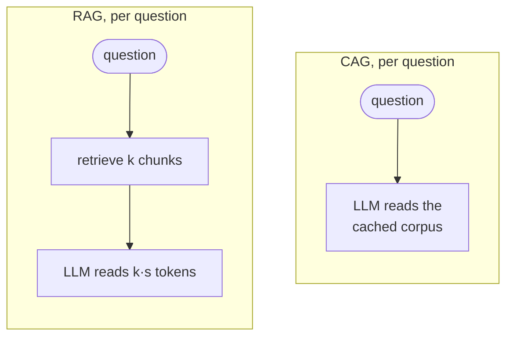

# Cache-Augmented Generation

## TL;DR
Skip retrieval entirely: put the **whole corpus** in the prompt and use **prompt/KV caching** so you pay to process it once rather than per query. There are no retrieval errors, no chunking and no index. It's bounded by the context window, it degrades on facts buried mid-context ("lost in the middle"), and every query still pays (cached) attention over the full corpus. It's the right answer for a small, static corpus.

## Intuition
Retrieval exists because the corpus doesn't fit in the prompt. When it *does* fit, every retrieval step is a chance to drop the relevant passage. With million-token context windows and cached prefixes, "a few hundred thousand tokens" now fits comfortably.

**This repo's corpus is ~12.5k characters ≈ 3k tokens.** All three sample documents fit in one prompt with plenty of room. CAG is therefore the obvious *ceiling* baseline for the benchmark: if Naive/Graph/Vectorless RAG score below "just read everything", their retrieval is losing information.

## Formulation
Corpus $\mathcal D$ with $|\mathcal D|$ tokens. Per query $q$:

$$
y\sim p_\theta(y\mid \mathcal D, q),\qquad \text{feasible iff } |\mathcal D|+|q|+|y|\le L_\text{ctx}
$$

**Cost model** (per query, with a cached prefix): $c_\text{read}\cdot|\mathcal D|+c_\text{in}\cdot|q|+c_\text{out}\cdot|y|$, where cached-read price $c_\text{read}$ is typically a fraction (~10–25%) of the normal input price $c_\text{in}$. A one-time cache write costs $\approx c_\text{in}\cdot|\mathcal D|$ (sometimes with a premium), plus storage per hour for some providers.

Compared to RAG with $k$ chunks of size $s$: RAG reads $ks\ll|\mathcal D|$ tokens per query, so it's cheaper per query once $|\mathcal D|$ is large. CAG wins on simplicity and recall.

**Lost in the middle:** accuracy on facts placed in the middle of a long context drops relative to the beginning/end (Liu et al.). Newer models are much better at this, but not perfect. Verify on your own needle tests.

## Algorithm
1. Concatenate the corpus (with document titles and separators) into a stable prefix.
2. Create/refresh the cache (explicit cache API, or automatic prefix caching).
3. Per query: cached prefix + question → answer. Ask for citations by document title.

## Pros / cons
| Pros vs. [[Naive RAG]] | Cons |
|---|---|
| No retrieval errors, chunking, or index | Bounded by the context window |
| Whole-corpus reasoning: themes, multi-hop | Per-query cost ∝ corpus size (even if cached) |
| Simplest possible system | Lost-in-the-middle; distraction from irrelevant text |
| | Cache invalidated whenever the corpus changes |

## When to use
Small, static corpora: a product manual, a policy handbook, a single long contract, a support bot for one product. And **always as an eval baseline** when the corpus fits.

## Combines with
[[Conversational memory RAG]] (user profile in a cached system prompt). Prompt caching is also what makes [[Contextual retrieval]]'s ingest cheap.

## Implementation notes
Not implemented yet. **Suggested next variant for the benchmark**: `rag/cag.py` that loads `data/sample_texts/*.txt` into one prompt (Gemini supports explicit context caching) and answers. Add a runner + registry entry (`cag` → [[Cache-Augmented Generation]]). Faithfulness can be judged against the full corpus as context.

## Results
No implementation yet.

## References
- Chan et al. (2024). *Don't Do RAG: When Cache-Augmented Generation is All You Need.* https://arxiv.org/abs/2412.15605
- Liu et al. (2023). *Lost in the Middle.* https://arxiv.org/abs/2307.03172
