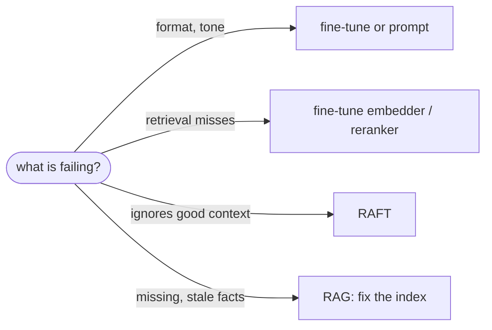
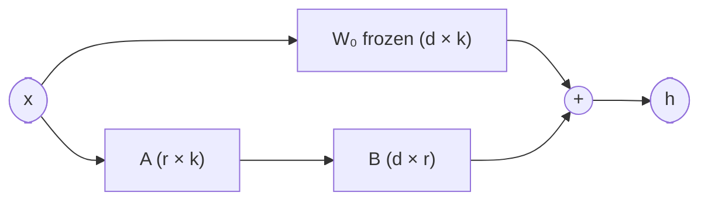

# Fine-tuning vs RAG

## TL;DR
Fine-tuning teaches **behavior**: style, format, tone, domain jargon, how to use context, when to refuse. It's a poor way to teach **facts**, especially facts that change or must be cited. RAG supplies facts at query time. They're complementary, not competitors. The best-known combination, **RAFT**, fine-tunes a model *to be better at RAG*: use the right documents and ignore distractors.

## Intuition
Fine-tuning compresses training text into weights. Facts seen a few times are learned unreliably, can't be cited, can't be updated without retraining, and can increase hallucination ("the model learned to sound confident about this domain"). Retrieval keeps facts in an external, inspectable, updatable store.

| Need | Use |
|---|---|
| Current, changing, or private facts | RAG |
| Citations / provenance | RAG |
| Output format, tone, structured output | Fine-tuning (or prompting) |
| Domain vocabulary, reading skill | Fine-tuning |
| Better use of retrieved context | RAFT (fine-tune *for* RAG) |
| Better retrieval in a niche domain | Fine-tune the **embedder** or **reranker** |

## Formulation
**Full fine-tuning** minimizes the next-token loss $\mathcal L=-\sum_t\log p_\theta(y_t\mid x,y_{<t})$ over domain data.

**LoRA** (the usual parameter-efficient method): freeze $W_0\in\mathbb R^{d\times k}$ and learn a low-rank update

$$
W=W_0+\frac{\alpha}{r}BA,\qquad B\in\mathbb R^{d\times r},\ A\in\mathbb R^{r\times k},\ r\ll\min(d,k)
$$

Trainable parameters drop from $dk$ to $r(d+k)$. For $d=k=4096$, $r=8$: 16.8M → 65.5k per matrix (256× fewer).

**RAFT training example:** (question $Q$, oracle doc $D^*$, distractors $D_1..D_n$) → target = chain-of-thought answer that **quotes** $D^*$. For a fraction $1-P$ of examples, the oracle is *removed*, so the model also learns not to rely blindly on context.

## Algorithm
Decision procedure:
1. Start with prompting + RAG.
2. If failures are **format/behavior**: fine-tune (or improve prompts).
3. If failures are **retrieval misses in a niche domain**: fine-tune the embedding model or reranker on (query, positive, hard negative) pairs.
4. If failures are **misuse of good context** (distracted, ignores the evidence): RAFT-style fine-tuning.

## Pros / cons
| Fine-tuning pros | Fine-tuning cons |
|---|---|
| Lower latency (no retrieval), shorter prompts | Facts can't be updated without retraining |
| Consistent style and format | No citations; hallucination risk on unseen facts |
| Domain skill | Training data + compute + eval infrastructure |
| | Catastrophic forgetting of general skills |

## When to use
Fine-tune for behavior and for retrieval components; RAG for knowledge. Ovadia et al. found RAG consistently outperformed unsupervised fine-tuning for injecting both previously seen and new knowledge.

## Combines with
[[Naive RAG]] and any variant (RAFT model as generator), [[Dense retrieval]] / [[Cross-encoder reranking]] (domain-tuned retrieval models). Historical cousin: [[Trained retrieval]].

## Implementation notes
Not planned for this repo (API models). Gemini supports supervised tuning on some models; for open models use PEFT/LoRA (`peft`, `trl`, Unsloth). Embedding fine-tuning: `sentence-transformers` with `MultipleNegativesRankingLoss`.

## Results
Not applicable.

## References
- Ovadia et al. (2023). *Fine-Tuning or Retrieval?* https://arxiv.org/abs/2312.05934
- Zhang et al. (2024). *RAFT.* https://arxiv.org/abs/2403.10131
- Hu et al. (2021). *LoRA.* https://arxiv.org/abs/2106.09685
