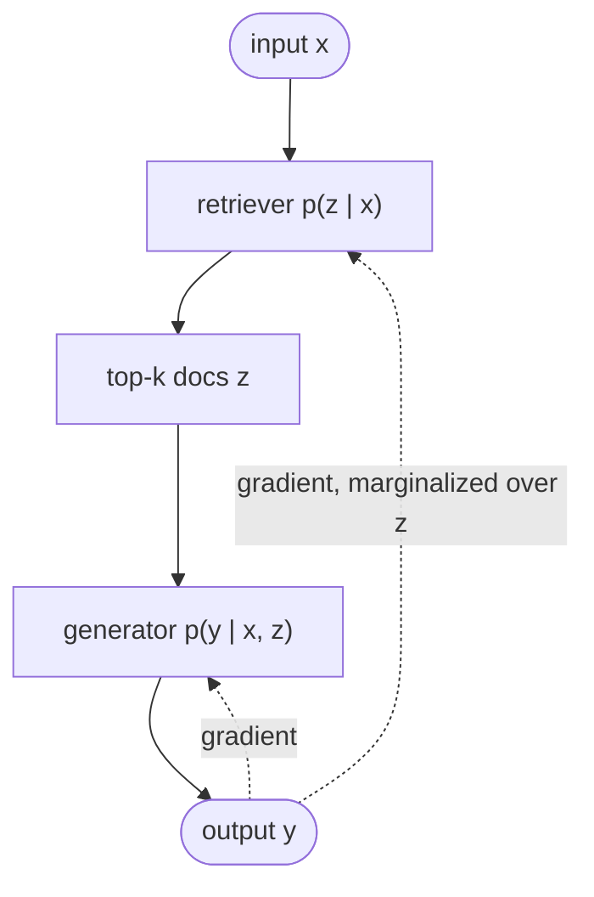

# Trained retrieval

## TL;DR
The original RAG research line: the **retriever and generator are trained together**, so the retriever learns to fetch whatever helps the generator predict the right output. REALM, the original RAG paper, Fusion-in-Decoder, RETRO and Atlas all belong here. They matter historically and conceptually, and they explain where today's terms come from. They're impractical unless you train your own models. Today's "RAG" with frozen API LLMs is the *non-trained* descendant.

## Intuition
In [[Naive RAG]] the retriever never learns whether its picks helped. In trained RAG, the retrieved document is a **latent variable**: the model marginalizes over which document it *could* have used, so gradients flow back into the retriever and reward documents that made the answer more likely. No relevance labels are needed; the downstream loss supplies the signal.

## Formulation
**REALM** (retrieval as a latent variable, during *pre-training* with masked-LM):

$$
p(y\mid x)=\sum_{z\in\mathcal Z}p(y\mid z,x)\,p(z\mid x),\qquad
p(z\mid x)=\frac{\exp f(x,z)}{\sum_{z'}\exp f(x,z')},\quad f(x,z)=E_\text{in}(x)^\top E_\text{doc}(z)
$$

The sum over all documents is approximated by the top-$k$ from maximum inner product search (MIPS). The document index is asynchronously re-embedded as $E_\text{doc}$ trains.

**RAG (Lewis et al.)**, DPR retriever $p_\eta$ + BART generator $p_\theta$, fine-tuned end to end (document encoder frozen):

$$
\text{RAG-Sequence:}\quad p(y\mid x)\approx\sum_{z\in\text{top-}k}p_\eta(z\mid x)\prod_{i}p_\theta(y_i\mid x,z,y_{<i})
$$

$$
\text{RAG-Token:}\quad p(y\mid x)\approx\prod_{i}\sum_{z\in\text{top-}k}p_\eta(z\mid x)\,p_\theta(y_i\mid x,z,y_{<i})
$$

RAG-Sequence uses one document for the whole answer; RAG-Token can switch documents per token.

**Fusion-in-Decoder (FiD):** encode each (question, passage$_j$) pair *separately*, concatenate all encoder outputs, and let the decoder attend over all of them. Encoder cost is linear in the number of passages, so FiD scales to ~100 passages. This was the precursor of "stuff many chunks in the prompt".

**RETRO:** a decoder LM with **chunked cross-attention**. Each 64-token chunk of the input retrieves nearest-neighbor chunks (frozen BERT embeddings) from a trillions-of-tokens database, and the model cross-attends to them. Knowledge moves from parameters into the database.

**Atlas:** a Contriever retriever + T5 FiD reader trained jointly (several loss options, e.g. distilling the reader's attention into the retriever). Strong few-shot knowledge-intensive QA with far fewer parameters than closed-book LMs.

## Algorithm
Training loop (RAG-style): retrieve top-$k$ with the current query encoder → compute the marginal likelihood of the target → backprop into the generator and query encoder → periodically refresh the document index if the doc encoder is trained.

## Pros / cons
| Pros | Cons |
|---|---|
| Retriever optimized for the end task, no relevance labels | Requires training both models and a big compute budget |
| Smaller models match much larger closed-book ones (reported for RETRO, Atlas) | Index refresh during training is expensive |
| Updatable knowledge by swapping the index | Not applicable to closed API LLMs |

## When to use
Research, or organizations training their own LMs. For everyone else this is background knowledge. The modern equivalent is fine-tuning the *embedding model* or *reranker* on your data, keeping the LLM frozen.

## Combines with
Conceptual ancestor of [[Dense retrieval]] (DPR came from this line), [[Cross-encoder reranking]] (reader-to-retriever distillation), and the "knowledge in the index, not the weights" argument in [[Fine-tuning vs RAG]].

## Implementation notes
Not planned for this repo (needs GPU training). Hugging Face `transformers` has `RagSequenceForGeneration` / `RagTokenForGeneration` for experiments.

## Results
Not applicable.

## References
- Guu et al. (2020). *REALM.* https://arxiv.org/abs/2002.08909
- Lewis et al. (2020). *RAG.* https://arxiv.org/abs/2005.11401
- Izacard & Grave (2021). *FiD.* https://arxiv.org/abs/2007.01282
- Borgeaud et al. (2022). *RETRO.* https://arxiv.org/abs/2112.04426
- Izacard et al. (2022). *Atlas.* https://arxiv.org/abs/2208.03299
