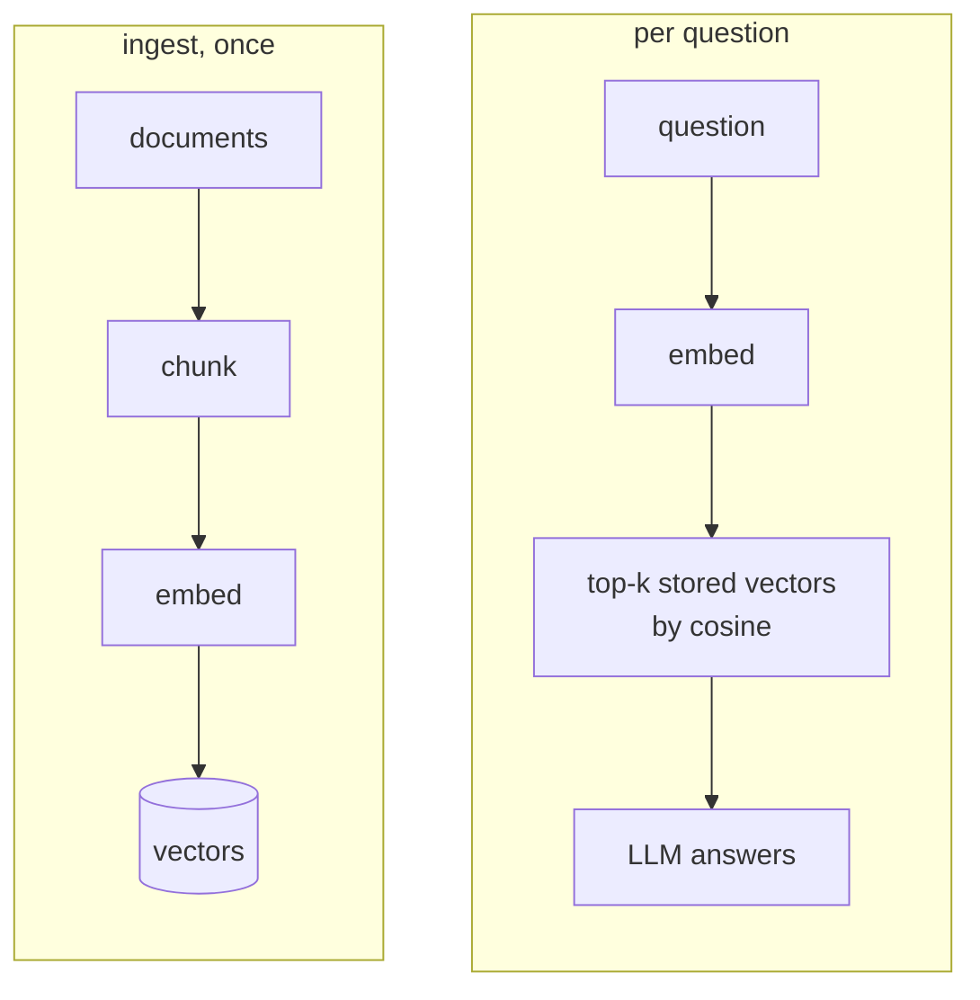

# Naive RAG

## TL;DR
Chunk the corpus, embed each chunk, store the vectors, and at query time embed the question, take the top-$k$ most similar chunks, paste them into the prompt, and generate. It's the baseline every other variant is measured against: cheap, fast, easy to debug. It falls short when the answer is spread across chunks, needs exact-term matching, or needs reasoning over relationships.

## Intuition
"Open-book exam with a good index." The model doesn't need to remember facts; it just needs the right page in front of it. The embedding model is the index: it puts texts with similar *meaning* near each other in vector space, so the question's nearest neighbors are, hopefully, the passages that answer it.



![[chunk_embeddings_pca-light.svg]]![[chunk_embeddings_pca-dark.svg]]
*This repo's real chunk embeddings, projected to 2-D. Each document forms its own cluster, so a top-5 neighborhood usually sits inside one document, a hint at why cross-document theme questions are hard for this variant. Generated by `rag/viz/figures.py` (`chunk_embeddings_pca`).*

## Formulation
Let $f:\text{text}\to\mathbb R^{d}$ be the embedding model, $c_1,\dots,c_N$ the chunks, and $q$ the question. With L2-normalized vectors $\hat{\mathbf e}_i = f(c_i)/\lVert f(c_i)\rVert$ and $\hat{\mathbf q}=f(q)/\lVert f(q)\rVert$:

$$
s_i = \hat{\mathbf q}\cdot\hat{\mathbf e}_i = \cos\big(f(q), f(c_i)\big)\in[-1,1]
$$

$$
\mathcal C_k(q) = \operatorname*{arg\,top\text{-}k}_{i\in\{1..N\}}\; s_i
$$

The answer is sampled from the LLM conditioned on the stuffed prompt: $y\sim p_\theta\big(y \mid \text{instr}, \mathcal C_k(q), q\big)$.

- $d$: embedding dimension (3072 for `gemini-embedding-001` by default).
- $N$: number of chunks; $k$: chunks retrieved (here 5).
- Normalizing once at index time turns cosine similarity into a single matrix–vector product $E\hat{\mathbf q}$, where $E\in\mathbb R^{N\times d}$.

**Worked example (toy, 3-d):** $\hat{\mathbf q}=(0.6,0.8,0)$; chunk A $=(0.8,0.6,0)$, chunk B $=(0,0.6,0.8)$. $s_A=0.48+0.48=0.96$, $s_B=0+0.48+0=0.48$ → A ranks first.

## Algorithm
**Ingest**
1. Split each document into overlapping windows ([[Chunking strategies]]).
2. Embed every chunk; L2-normalize; store matrix $E$ and chunk metadata.

**Query**
1. Embed the question and normalize.
2. Scores $= E\hat{\mathbf q}$; take the top-$k$ indices.
3. Build the prompt: instructions ("answer only from context, say if insufficient") + chunks with source tags + question.
4. Generate.

## Pros / cons
| Pros | Cons |
|---|---|
| Simple; few moving parts | Chunk boundaries cut facts apart |
| Cheap ingest (one embedding per chunk), low latency | Misses exact identifiers, codes, rare names (see [[BM25]], [[Hybrid search]]) |
| Easy to debug: you can print what was retrieved | No signal when retrieval is bad (see [[Corrective RAG]]) |
| Works with any LLM | Fails at multi-hop and corpus-wide "themes" questions (see [[GraphRAG]], [[RAPTOR]], [[Iterative retrieval]]) |

## When to use
- FAQ bots and small docs sites where each question maps to one passage.
- As the **first baseline** in any project. Measure it before adding anything.
- Anti-pattern: thematic questions over the whole corpus. Top-$k$ of 5 chunks can't summarize 100 documents.

## Combines with
The "advanced RAG" upgrades all bolt onto this pipeline: [[Hybrid search]] (add BM25), [[Cross-encoder reranking]] (rerank a wider top-k), [[Query rewriting]] / [[HyDE]] (fix the query side), [[Contextual retrieval]] / [[Parent-document retrieval]] (fix the chunk side).

## Implementation notes
Code: [standard_rag.py](../../../rag/standard_rag.py) (`StandardRAG`, `TextChunker`), demo: [05_standard_rag_demo.py](../../../examples/05_standard_rag_demo.py).

- Chunking: character windows, `chunk_size=600`, `overlap=100` (see [[Chunking strategies]] for a tail-window quirk).
- Embeddings: Gemini `gemini-embedding-001`, one API call per chunk (no batching; slow to index large corpora).
- Index: a plain numpy matrix with exact search, no [[ANN indexes]]. Fine for hundreds of chunks; use FAISS/HNSW past ~100k.
- Generation: `gemini-2.5-flash`, `top_k=5`. The prompt tells the model to answer only from context.
- Cached index: `output/rag_index/` (`embeddings.npy` + `chunks.json`).
- Benchmark key: `standard_rag` in `rag/eval/registry.py`.

## Results
```dataview
TABLE dataset, answer_correctness, faithfulness, entity_coverage, context_entity_recall, latency_s_p50, commit
FROM "notes/results/naive-rag"
SORT run_id DESC
```
Static view: [[Leaderboard]].

## References
- Lewis et al. (2020). *Retrieval-Augmented Generation for Knowledge-Intensive NLP Tasks.* https://arxiv.org/abs/2005.11401. Coined "RAG", though with a jointly trained retriever ([[Trained retrieval]]).
- Gao et al. (2023). *Retrieval-Augmented Generation for Large Language Models: A Survey.* https://arxiv.org/abs/2312.10997. Names the naive / advanced / modular RAG tiers.
