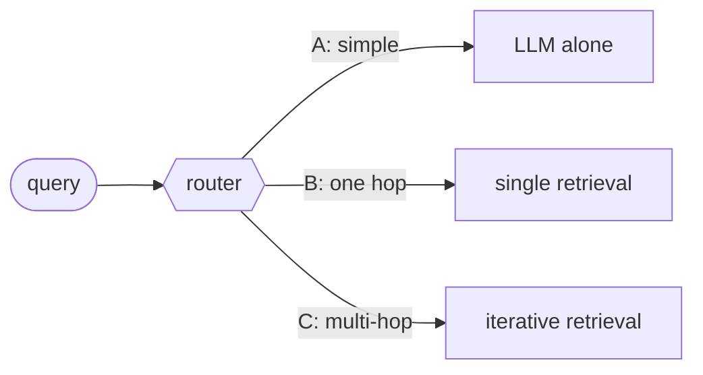

# Adaptive RAG

## TL;DR
A cheap classifier looks at each incoming query and **routes** it: **no retrieval** (the LLM already knows), **single-step** retrieval ([[Naive RAG]]-style), or **multi-step** retrieval ([[Iterative retrieval]]). Easy queries stay cheap and hard queries get the heavy machinery. Its weak point is the router: when it's wrong, the error propagates.

## Intuition
Running a multi-hop pipeline on "What is 2+2?" wastes money. Running one retrieval on "Who was CEO of the company that acquired X when Y launched?" fails. Real traffic mixes both. A router is a triage nurse: it spends a little effort per query to allocate a lot of effort well. The same idea generalizes to routing between *sources* (vector index vs SQL vs web) and between *variants* (naive vs [[GraphRAG]] global for thematic queries).

The benchmark here already uses a hand-written router of this kind: `thematic` questions go to GraphRAG global search, everything else to local (`graphrag_method` in [runners.py](../../../rag/eval/runners.py)).

## Formulation
Classifier $g:q\mapsto\{A,B,C\}$ (complexity labels):

$$
\text{answer}(q)=\begin{cases}
\text{LLM}(q) & g(q)=A\ \text{(no retrieval)}\\
\text{LLM}(q,\mathcal C_k(q)) & g(q)=B\ \text{(single-step)}\\
\text{IterRAG}(q) & g(q)=C\ \text{(multi-step)}
\end{cases}
$$

**Getting labels without humans (Adaptive-RAG):** run all three strategies on training questions; label = the *simplest* strategy that answers correctly. If none do, fall back to the dataset's nature (single-hop datasets → B, multi-hop → C). Then train a small classifier (T5-large in the paper).

Expected cost: $\mathbb E[\text{cost}]=\sum_{s} P(g(q)=s)\,\text{cost}_s$. Routing pays off when $P(A)+P(B)$ is large and the router is accurate.

## Algorithm
1. Classify the query (small fine-tuned model, an LLM with a routing prompt, or rules/keywords).
2. Dispatch to the chosen pipeline.
3. (Optional) escalate: if the cheap path's answer fails a check ([[Corrective RAG]] grader, low confidence), re-run on the next tier.

## Pros / cons
| Pros | Cons |
|---|---|
| Saves cost and latency on easy queries | Router errors propagate (under-routing = wrong answers) |
| Lets you deploy expensive pipelines only where needed | Needs labeled or synthetic training data |
| Natural place to add source routing (SQL vs text) | Another component to monitor and evaluate |

## When to use
Mixed-traffic assistants; tight latency or cost budgets; systems that combine several pipelines or sources.

## Combines with
[[Iterative retrieval]] (the "C" path), [[Text-to-SQL RAG]] (a route), [[Corrective RAG]] (escalation trigger), [[Speculative RAG]] (fast path for high volume).

## Implementation notes
Not implemented yet. The benchmark question `type` field (`factual` / `relational` / `thematic` / `multi_hop`) is a ready-made label set. Experiment: an LLM router that predicts the type, routing `thematic` → GraphRAG global, `multi_hop` → Vectorless/iterative, others → Naive RAG. Compare correctness and cost against each variant alone.

## Results
No implementation yet.

## References
- Jeong et al. (2024). *Adaptive-RAG.* NAACL. https://arxiv.org/abs/2403.14403
