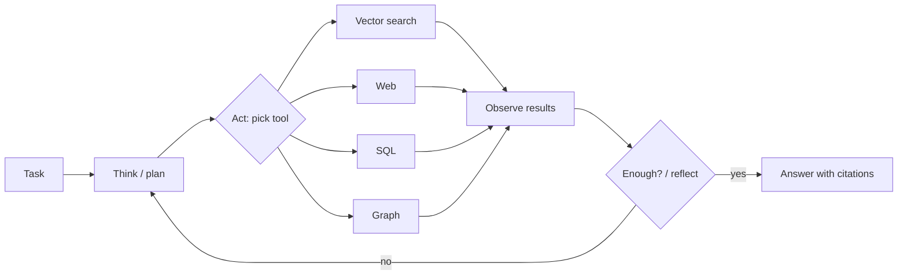

# Agentic RAG

## TL;DR
Give an LLM agent **retrieval as tools**: several indexes, web search, SQL, a graph, a calculator. It plans, calls tools, reads results, reflects, and loops until it decides it has enough to answer. It's the most flexible option and the best at open-ended, multi-source tasks. It's also the most expensive, slowest, least deterministic and hardest to evaluate. Use it only when simpler control flows demonstrably fail.

## Intuition
Every other control-flow variant hard-codes *when* and *what* to retrieve. [[Adaptive RAG]] picks one of a few fixed paths; [[Iterative retrieval]] loops on a fixed pattern. An agent makes those decisions itself at every step. "Compare our Q3 churn with competitors' public statements" means: SQL for churn, web for competitors, the docs index for definitions, and then reconcile. No fixed pipeline anticipates that.

## Formulation
ReAct loop with history $h_t=(q,\ \tau_1,a_1,o_1,\dots,\tau_{t-1},a_{t-1},o_{t-1})$:

$$
\tau_t,\ a_t\sim\pi_\text{LLM}(\cdot\mid h_t),\qquad o_t=\text{Tool}_{a_t}(\text{args}_t)
$$

- $\tau_t$: thought (reasoning text); $a_t$: action = tool + arguments (or `finish`); $o_t$: observation.
- Stops when $a_t=\text{finish}$ or $t=T_\text{max}$ (always set a budget).
- Multi-agent variants split roles: a planner, per-source retriever agents, a critic/verifier.

Cost $\approx\sum_t(\text{LLM call on }|h_t|\text{ tokens})+\text{tool costs}$. History grows each step, so cost is superlinear in steps unless you summarize the history.

## Algorithm
1. System prompt: tools with clear descriptions + when to use each; answer format; citation rules; budget.
2. Loop: model emits a tool call → execute → append the observation (truncated) → repeat.
3. Optional reflection step: "Is the evidence sufficient and consistent?" (Reflexion-style).
4. Final answer with citations to tool outputs.

## Pros / cons
| Pros | Cons |
|---|---|
| Handles open-ended, multi-source, multi-step tasks | Highest cost and latency |
| Decides retrieval strategy per task | Nondeterministic; same question gives different paths |
| Can verify and cross-check sources | Hard to evaluate (trajectory + answer) and debug |
| Easy to add new sources (just add a tool) | Failure modes: loops, tool misuse, premature `finish` |

## When to use
Research assistants, enterprise copilots spanning many systems, analyst tools. Not for a docs FAQ bot.

## Combines with
Each other variant can be a tool: [[GraphRAG]], [[Text-to-SQL RAG]], [[Web-search RAG]], [[Hybrid search]], [[Vectorless RAG]] (tree navigation is naturally agentic). [[Iterative retrieval]] is the special case with a single tool and a fixed policy.

## Implementation notes
Not implemented yet. Frameworks: LangGraph, LlamaIndex agents, the Claude Agent SDK, OpenAI Agents SDK, Google ADK. Or a hand-rolled tool-use loop over the Gemini function-calling API. For this repo: expose `StandardRAG.retrieve`, `VectorlessRAG.retrieve` and GraphRAG local search as three tools, and let the agent choose per question. Log full trajectories; evaluate answer correctness *and* the number of steps.

## Results
No implementation yet.

## References
- Yao et al. (2023). *ReAct.* https://arxiv.org/abs/2210.03629
- Shinn et al. (2023). *Reflexion.* https://arxiv.org/abs/2303.11366
- Singh et al. (2025). *Agentic RAG survey.* https://arxiv.org/abs/2501.09136
