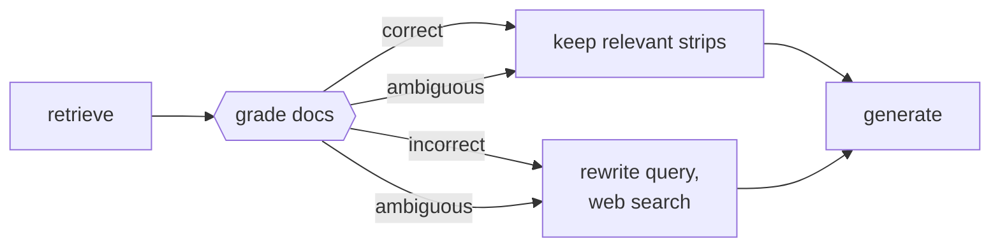

# Corrective RAG

## TL;DR
After retrieval and **before** generation, a lightweight **retrieval evaluator** grades the retrieved documents. If they're good, refine them (keep only relevant sentences). If they're bad, throw them away, rewrite the query, and fall back to **web search**. If it's unclear, do both. This makes the pipeline resilient to the silent failure of [[Naive RAG]], which happily generates from irrelevant context.

## Intuition
Naive RAG has no smoke detector. If retrieval returns five chunks about the wrong Caesar, the LLM either hallucinates from them or says "not enough information". CRAG adds a checkpoint: *"is this context actually about the question?"*. Grading relevance is a much easier task than answering, so a small model can do it reliably.

## Formulation
Evaluator $e(q,d)\in[-1,1]$ for each retrieved $d\in\mathcal C_k(q)$. Thresholds $\tau_\text{low}<\tau_\text{up}$:

$$
\text{action}=\begin{cases}
\text{Correct} & \exists d:\ e(q,d)>\tau_\text{up}\\
\text{Incorrect} & \forall d:\ e(q,d)<\tau_\text{low}\\
\text{Ambiguous} & \text{otherwise}
\end{cases}
$$

**Knowledge refinement ("decompose-then-recompose"):** split each kept document into strips (≈ sentences) $u$, score $e(q,u)$, keep strips above a threshold, concatenate in order. This removes noise *inside* relevant documents.

## Algorithm
1. Retrieve top-$k$.
2. Score each doc with the evaluator (paper: fine-tuned T5-large; in practice often an LLM grader prompt or [[Cross-encoder reranking]] scores).
3. Branch: Correct → refine. Incorrect → LLM rewrites the query into keywords → web search → refine the web results. Ambiguous → both, merged.
4. Generate from the corrected knowledge.

## Pros / cons
| Pros vs. [[Naive RAG]] | Cons |
|---|---|
| Resilient to bad retrieval; fewer confident wrong answers | Grader latency (+1 call or model per doc) |
| Fills coverage gaps via web | Web results: variable quality, freshness ≠ correctness |
| Strip-level refinement shrinks the prompt | Thresholds need tuning; grader can be wrong |
| Plug-and-play around any retriever | Web fallback may be unacceptable for private-data apps |

## When to use
Corpora with coverage gaps (a support bot that sometimes gets out-of-scope questions); freshness-sensitive domains; anywhere "I don't know" is better than a wrong answer (use a "say you don't know" fallback instead of web search if web access isn't allowed).

## Combines with
[[Web-search RAG]] (the fallback), [[Query rewriting]] (for the fallback query), [[Cross-encoder reranking]] (scores = cheap grader), [[Adaptive RAG]] (escalation). Compare [[Self-RAG]], which grades *inside* the generator via trained reflection tokens.

## Implementation notes
Not implemented yet. LangGraph has a well-known CRAG tutorial (grader node → conditional edge → web search node). In this repo: wrap `StandardRAG.retrieve` with a Gemini grader prompt (`{"relevant": true/false}` per chunk). Without web access, the "Incorrect" branch answers "not in corpus". Evaluate on questions *outside* the corpus to measure abstention.

## Results
No implementation yet.

## References
- Yan et al. (2024). *Corrective Retrieval Augmented Generation.* https://arxiv.org/abs/2401.15884
