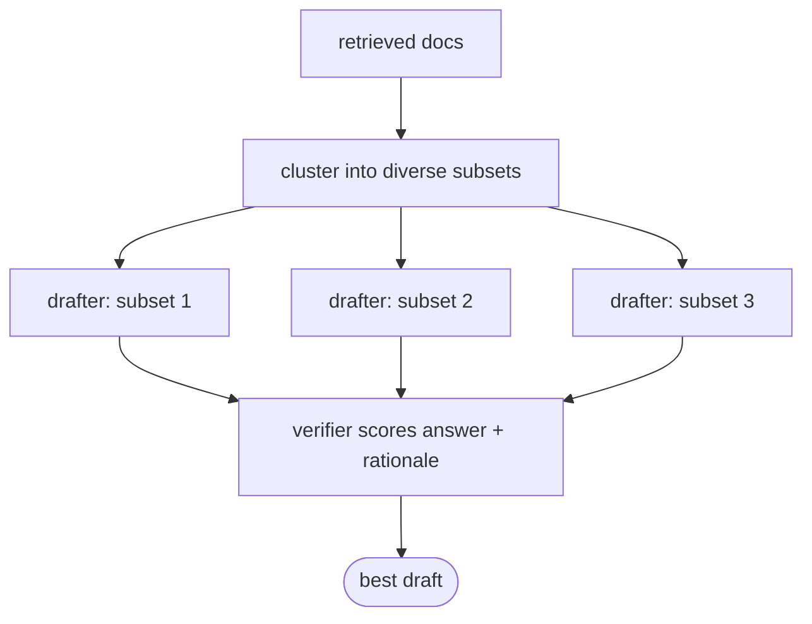

# Speculative RAG

## TL;DR
Split the retrieved documents into several small, diverse subsets. A **small specialist "drafter"** model writes one draft answer (with a rationale) per subset, in parallel. A **large generalist "verifier"** model scores the drafts *without re-reading all the documents* and picks the best one. You get answers faster and cheaper than having the big model read everything, often with better accuracy because each draft sees less noise.

## Intuition
Named after speculative decoding (a small model proposes, a big model checks). Reading 20 retrieved passages with a frontier model is slow, and the many marginal passages distract it. Instead, several cheap drafters each read a few passages and commit to an answer plus a short rationale. The big model then only has to judge which (answer, rationale) pair is most convincing, which is a much shorter input. Diversity across subsets means at least one draft is likely to have the right evidence.

## Formulation
1. Embed the retrieved docs $\mathcal D$, cluster them into $k$ groups (k-means), and form $m$ subsets $\delta_1..\delta_m$, each taking one doc from each cluster. This gives diverse perspectives and minimal redundancy.
2. Drafter $\mathcal M_D$ (small, RAG-instruction-tuned) produces, for each subset, $(\alpha_j,\beta_j)\sim\mathcal M_D(\cdot\mid q,\delta_j)$: answer $\alpha_j$, rationale $\beta_j$.
3. Verifier $\mathcal M_V$ (large, *not* fine-tuned) scores each draft by its own probabilities:

$$
\rho_j=\rho_{\text{draft},j}\cdot\rho_{\text{SC},j}\cdot\rho_{\text{SR},j},\qquad \hat\alpha=\alpha_{\arg\max_j\rho_j}
$$

- $\rho_\text{draft}$: drafter's confidence in its rationale/answer.
- $\rho_\text{SC}$ (self-consistency): verifier's probability of generating $(\alpha_j,\beta_j)$ given $q$.
- $\rho_\text{SR}$ (self-reflection): verifier's probability of "Yes" to "Does the rationale support the answer?".
The verifier reads only $q,\alpha_j,\beta_j$ (short), not $\delta_j$.

## Algorithm
Retrieve → cluster → build $m$ subsets → $m$ parallel drafter calls → verifier scores (one forward pass per draft, no generation needed) → return the best draft.

## Pros / cons
| Pros | Cons |
|---|---|
| Lower latency/cost than a large model reading all docs | Two models to host; drafter ideally fine-tuned |
| Parallel drafting; less noise per draft | Verifier needs token log-probs |
| Rationales give some explainability | Answers are limited by the small model's ability |

## When to use
High-volume QA with latency budgets, when you can host a small fine-tuned model next to a large one.

## Combines with
[[Adaptive RAG]] (use as the fast path), [[Hybrid search]] (retrieval feeding the drafts).

## Implementation notes
Not implemented yet. Hosted APIs make this awkward because the verifier needs log-probs of given text. A prompted approximation: Gemini Flash-Lite drafts per subset; Gemini Pro picks among drafts in one call.

## Results
No implementation yet.

## References
- Wang et al. (2024). *Speculative RAG.* https://arxiv.org/abs/2407.08223
- Leviathan, Kalman & Matias (2023). *Fast Inference from Transformers via Speculative Decoding.* https://arxiv.org/abs/2211.17192
