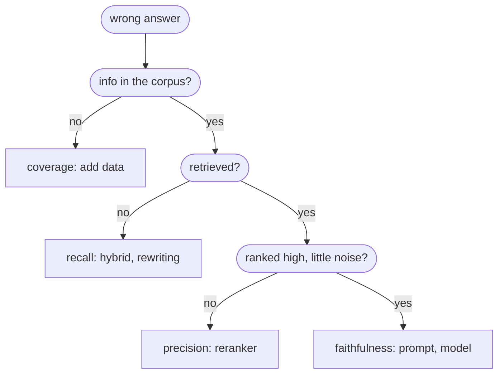
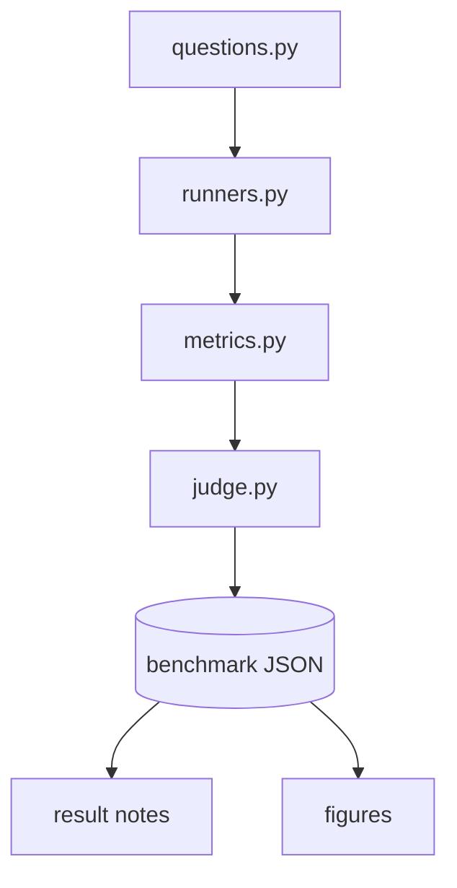

# RAG evaluation

## TL;DR
Evaluate **retrieval** (did we fetch what's needed?) and **generation** (is the answer correct and grounded in what we fetched?) separately; otherwise you can't tell which half to fix. Build the eval set **before** adding variants. Every "add X" decision in the [[RAG map]] should be triggered by an observed eval failure. This repo's harness (`rag/eval/`) measures answer correctness and faithfulness (LLM judge), entity coverage, context entity recall (string match), latency and tokens. Results land in [[Leaderboard]].

## Intuition
A RAG answer can fail in four distinct ways:
1. The needed info isn't in the corpus (coverage).
2. It's in the corpus but wasn't retrieved (**retrieval recall**).
3. It was retrieved but buried in noise (**retrieval precision**).
4. It was retrieved but the generator ignored or contradicted it (**faithfulness**), or answered a different question (**relevance**).

Each failure has a different fix (more data / [[Hybrid search]] / [[Cross-encoder reranking]] / prompt or model change), so the metrics must separate them.

## Formulation
**Ranking metrics** (need gold relevant passages $G_q$):

$$
\text{recall@}k=\frac{|\text{top-}k\cap G_q|}{|G_q|},\qquad
\text{MRR}=\frac1{|Q|}\sum_{q}\frac{1}{\text{rank of first relevant}},\qquad
\text{nDCG@}k=\frac{\sum_{i=1}^{k}\frac{2^{\text{rel}_i}-1}{\log_2(i+1)}}{\text{IDCG@}k}
$$

**RAGAS-style metrics** (LLM-assisted, no gold passages):
- *Faithfulness* $=\frac{|\text{answer claims supported by context}|}{|\text{answer claims}|}$ (decompose the answer into atomic claims, verify each one).
- *Answer relevancy*: generate questions from the answer and average their cosine similarity to the real question.
- *Context recall* $=\frac{|\text{reference claims attributable to context}|}{|\text{reference claims}|}$.
- *Context precision*: are the relevant chunks ranked at the top? (precision@$k$ averaged over the relevant positions).
- *Context entity recall* $=\frac{|E_\text{ref}\cap E_\text{ctx}|}{|E_\text{ref}|}$.

**What this repo computes** ([metrics.py](../../../rag/eval/metrics.py), [judge.py](../../../rag/eval/judge.py)):

| Field | Definition | Needs | Missing for |
|---|---|---|---|
| `answer_correctness` | Judge: share of the reference answer's key facts stated correctly, with contradictions penalized | `reference_answer` | — |
| `faithfulness` | Judge: share of answer claims supported by the retrieved context | captured context | GraphRAG (CLI hides context) |
| `entity_coverage` | share of `expected_entities` appearing (case-insensitive substring) in the **answer** | `expected_entities` | thematic questions (no entities) |
| `context_entity_recall` | the same, in the **retrieved context** | captured context | GraphRAG |
| `latency_s_p50` / `_mean` | wall-clock per question (median / mean) | — | — |
| `prompt_tokens_mean` | mean prompt tokens per question | usage metadata | GraphRAG |

Not computed (no gold passages): recall@k, MRR, nDCG. Gold passages are hard to define across variants that retrieve different units (chunks vs tree nodes vs graph elements); context entity recall is the variant-agnostic proxy.

## Algorithm
`python examples/06_benchmark.py`:
1. Questions + reference answers + expected entities from [questions.py](../../../rag/eval/questions.py) (10 questions: factual, relational, thematic, multi-hop over `data/sample_texts`).
2. Each runner in [runners.py](../../../rag/eval/runners.py) answers all questions and records `context_texts`.
3. String metrics → judge call per answer (`gemini-2.5-flash`, temperature 0, JSON mode) → per-variant summary.
4. Save `output/benchmark_results.json` + `output/runs/<run_id>.json`; export result notes and [[Leaderboard]] ([obsidian_export.py](../../../rag/eval/obsidian_export.py)).

![[benchmark_overview-light.svg]]![[benchmark_overview-dark.svg]]
*Latest run, redrawn by every `06_benchmark.py` run. Generated by `rag/viz/figures.py` (`benchmark_overview`).*

## Pros / cons and caveats
- **10 questions is a smoke test, not a benchmark.** A difference of 0.1 in mean correctness is within noise. Look at per-question tables and answers, not just means. Grow the set (and consider bootstrap confidence intervals) before drawing conclusions.
- **Substring matching** misses synonyms ("carbon dioxide" ≠ "CO2") and over-credits partial names ("Hinton" in "Hinton's").
- **LLM-judge biases:** self-preference (judge and generators are all Gemini), verbosity bias, position bias, and run-to-run noise. Compare variants only under the same judge model. Spot-check judge reasoning in the result notes.
- The judge does a **single holistic call**, not RAGAS's claim-by-claim decomposition. Cheaper, less precise.
- Thematic questions have key-point references; correctness there is coverage of themes, not a single fact.

## When to use
Always, first. Re-run after every change to retrieval, chunking, prompts or models. Each result note records the commit SHA (and whether the tree was dirty) so runs are traceable.

## Combines with
Every variant. Evaluated so far: [[Naive RAG]], [[GraphRAG]], [[Vectorless RAG]].

## Implementation notes
- Adding a variant: runner in `runners.py` + entry in `registry.py`; the export and leaderboard pick it up.
- Offline tests: [test_metrics.py](../../../tests/test_metrics.py), [test_judge.py](../../../tests/test_judge.py), [test_benchmark_export.py](../../../tests/test_benchmark_export.py).
- `--no-judge` skips judge calls; `--judge-model` swaps the judge.
- Libraries worth knowing: RAGAS, DeepEval, TruLens, ARES, promptfoo.

## Results
See [[Leaderboard]] (static) or [[RAG map#Leaderboard]] (Dataview).

## References
- Es et al. (2023). *RAGAS.* https://arxiv.org/abs/2309.15217
- Zheng et al. (2023). *Judging LLM-as-a-Judge.* https://arxiv.org/abs/2306.05685
- Saad-Falcon et al. (2023). *ARES.* https://arxiv.org/abs/2311.09476
