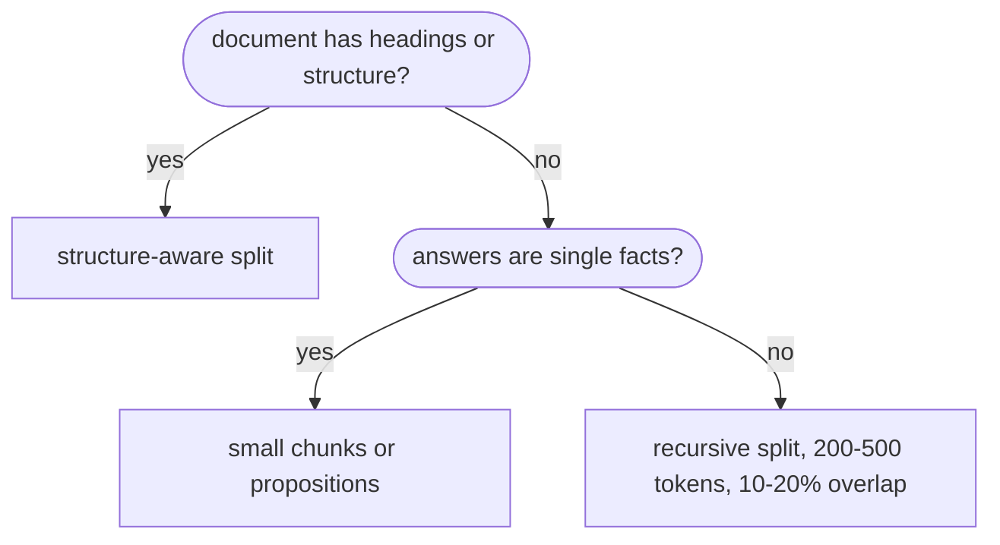

# Chunking strategies

## TL;DR
How you cut documents into retrievable units is the most underrated RAG hyperparameter. Chunks that are too big dilute the embedding and waste prompt tokens; chunks that are too small lose context; cut boundaries split facts in half. Start with **~200–500 tokens with 10–20% overlap, split on structure** (headings → paragraphs → sentences), and measure. This repo uses fixed 600-*character* windows with 100-char overlap.

## Intuition
An embedding is roughly the *average meaning* of its text. A 2000-token chunk covering three topics embeds to a blur that matches none of them well. A 1-sentence chunk embeds sharply but arrives in the prompt without the sentence before it ("He then crossed the Rubicon": who?). Overlap is cheap insurance against a boundary cutting through the one sentence you need. The variants [[Parent-document retrieval]], [[Sentence-window retrieval]] and [[Contextual retrieval]] all exist to escape this precision-vs-context trade-off.

![[chunk_windows-light.svg]]![[chunk_windows-dark.svg]]
*The repo's TextChunker on `ancient_rome.txt`: 600-char windows every 500 chars. Gray lines are paragraph breaks; most windows start or end mid-paragraph. Generated by `rag/viz/figures.py` (`chunk_windows`).*

## Formulation
**Fixed-size windows** with size $s$ and overlap $o$ (step $s-o$) over a text of length $L$:

$$
\text{window}_i=\text{text}\big[i(s-o),\ i(s-o)+s\big),\qquad i=0,1,\dots,\left\lceil\frac{L}{s-o}\right\rceil-1
$$

Storage overhead from overlap ≈ $\frac{s}{s-o}$ (here $600/500=1.2\times$).

**Semantic chunking:** embed consecutive sentences $u_1..u_T$ and cut between $u_t$ and $u_{t+1}$ where the distance $1-\cos(f(u_t),f(u_{t+1}))$ exceeds a threshold (e.g. its 95th percentile within the document).

## Strategies
| Strategy | Boundary rule | Good for | Watch out |
|---|---|---|---|
| Fixed-size (chars/tokens) + overlap | every $s-o$ units | baseline, uniform text | cuts sentences/tables mid-way |
| Recursive character | try `\n\n`, then `\n`, then `. `, then space | general prose | still size-driven |
| Sentence / paragraph | NLP sentence splitter | transcripts, articles | uneven sizes |
| Structure-aware | Markdown/HTML headings, PDF layout, code AST | docs, manuals, code | needs parsers |
| Semantic | embedding-distance breakpoints | topic-shifting text | extra embedding pass; threshold tuning |
| Propositions | LLM rewrites text into atomic self-contained facts | fact lookup | LLM cost at ingest |
| Late chunking | embed whole doc, pool token vectors per span | context-dependent chunks | needs long-context embedder |

## Pros / cons
Smaller chunks give higher precision and lower recall of surrounding context. Larger chunks are the reverse. Overlap reduces boundary loss but duplicates text and can return near-duplicate chunks.

## When to use
Always a decision. Tune chunk size on your eval set before trying fancier variants; it's free.

## Combines with
[[Parent-document retrieval]] and [[Sentence-window retrieval]] (retrieve small, return big), [[Contextual retrieval]] (repair orphaned chunks), [[RAPTOR]] (summaries over chunks).

## Implementation notes
`TextChunker` in [standard_rag.py](../../../rag/standard_rag.py): character windows, `chunk_size=600`, `overlap=100`, whitespace-stripped, empty windows dropped. The sample corpus (≈12.5k chars, 3 files) gives 27 chunks.

**Known quirk** (pinned by [test_chunker.py](../../../tests/test_chunker.py)): the loop runs while `i < len(text)`, so the last window can be a pure suffix of the previous one and add no new text. With $L=1050$, windows start at 0, 500, 1000, and the third (50 chars) is contained in the second. Harmless but wasteful, and it also creates a near-duplicate retrieval hit. A fix is to stop once a window reaches the end of the text. Changing it changes the index, so re-embed after.

Characters ≠ tokens: 600 chars ≈ 130–150 English tokens. GraphRAG uses 1200-*token* units, so the two variants see very different granularities.

## Results
Indirectly via [[Naive RAG]].

## References
- Chen et al. (2023). *Dense X Retrieval (propositions).* https://arxiv.org/abs/2312.06648
- Günther et al. (2024). *Late Chunking.* https://arxiv.org/abs/2409.04701
- Kamradt, G. *5 Levels of Text Splitting* (semantic chunking), github.com/FullStackRetrieval-com/RetrievalTutorials
