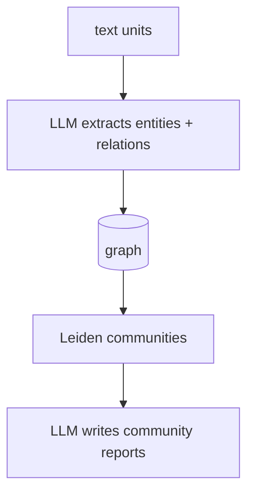
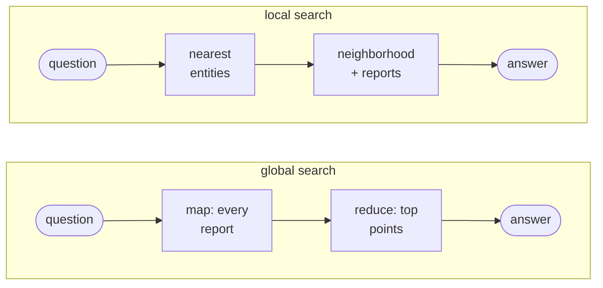

# GraphRAG

## TL;DR
An LLM reads every chunk and extracts **entities and relationships** into a knowledge graph. The graph is partitioned into a hierarchy of **communities**, and the LLM writes a summary report for each one. Queries are answered either **locally** (start from the entities that match the question and pull in their neighborhood) or **globally** (map-reduce over community reports). Reach for it when questions are relational ("how are X and Y connected?") or corpus-wide ("what are the main themes?"), which [[Naive RAG]] can't answer from 5 chunks. Expect indexing to be expensive.

## Intuition
Naive RAG retrieves *passages*. GraphRAG retrieves *structure*. If Caesar, Pompey and Crassus are mentioned in different paragraphs, vector search may find only one of them. In the graph they are three nodes joined by "formed the First Triumvirate with" edges, so a single hop pulls in all three. For "what are the themes?", there's no single passage to retrieve. Instead, GraphRAG precomputes summaries of every cluster of related entities, then reads all of them in parallel and merges the answers.





## Formulation
**Graph.** $G=(V,E)$ where $V$ = entities (name, type, LLM-summarized description) and $E$ = relationships (source, target, description, weight $w_{ij}$, e.g. how often the pair co-occurs across text units).

**Community detection.** Leiden maximizes modularity:

$$
Q=\frac{1}{2m}\sum_{i,j}\Big[A_{ij}-\gamma\frac{k_i k_j}{2m}\Big]\,\delta(c_i,c_j)
$$

- $A_{ij}$: edge weight between nodes $i,j$; $k_i=\sum_j A_{ij}$: weighted degree; $m=\tfrac12\sum_{ij}A_{ij}$: total edge weight.
- $\gamma$: resolution (higher → smaller communities); $c_i$: community of node $i$; $\delta$: 1 if same community.
- The term $\frac{k_ik_j}{2m}$ is the expected edge weight under a random graph with the same degrees. $Q$ rewards communities that are denser than chance.
- Leiden improves on Louvain by guaranteeing communities are internally connected. GraphRAG applies it **hierarchically**: communities larger than `max_cluster_size` are split again, giving levels C0 (coarse) … Cn (fine).

**Global search (map-reduce).** For community reports $r_1..r_M$ at a chosen level:
1. Map: $\text{LLM}(q, r_j)\to\{(\text{point}, h)\}$ with helpfulness $h\in[0,100]$.
2. Reduce: sort all points by $h$, drop $h=0$, fill the context window, and answer $\text{LLM}(q, \text{top points})$.

**Local search.** Take the entities $e$ with the highest $\cos(f(q), f(\text{desc}_e))$. Expand to their relationships, neighboring entities, source text units and community reports, rank each table, and fit the result into a fixed token budget split across the tables.

## Algorithm
**Ingest** (`python -m graphrag index --root ragtest`)
1. Chunk documents into text units (here: 1200 tokens, 100 overlap).
2. For each unit, the LLM extracts entities (types: organization, person, geo, event) and relationships, with up to `max_gleanings` extra "did you miss any?" passes.
3. Merge duplicate entities across units; the LLM summarizes their merged descriptions.
4. Build the graph and run hierarchical Leiden (`max_cluster_size: 10`).
5. LLM writes a report per community (title, summary, findings, rating).
6. Embed entity descriptions, text units and community reports (LanceDB).

**Query**
- *Local*: entity-centric questions ("What was Caesar's relationship with Pompey?").
- *Global*: thematic questions ("What are the main themes?").
- (Also available in graphrag: *DRIFT*, a local search primed with community context, and *basic* vector search.)

## Pros / cons
| Pros | Cons |
|---|---|
| Multi-hop and relational questions: relations are explicit edges | Ingest is many LLM calls per chunk (extraction + gleanings + summaries + reports) |
| Answers corpus-wide "sensemaking" questions via community reports | Global search is slow and costly: one LLM call per report |
| Graph is inspectable (see [[Glossary]]: entities, communities) | Extraction errors (missed or duplicated entities) are silent |
| Reports give pre-digested context, so less raw text goes in the prompt | Updating the corpus means re-extraction and re-clustering |
|  | Schema/prompt tuning per domain (`graphrag prompt-tune`) |

## When to use
- Investigations, intelligence analysis, biomedical literature, supply chains: domains where *who-relates-to-whom* matters.
- "Summarize the corpus" questions where naive top-$k$ is structurally incapable.
- Anti-pattern: single-fact lookups ("When was the Paris Agreement adopted?"). Naive RAG answers them faster and cheaper.
- Anti-pattern: fast-changing corpora.

## Combines with
- [[Agentic RAG]]: graph search as one tool among several.
- [[Iterative retrieval]]: follow edges step by step instead of one-shot local search.
- [[Hybrid search]] for the text-unit part of local search.
- Compare with [[RAPTOR]], which also builds a summary hierarchy, but by embedding-clustering chunks instead of extracting a graph. [[Vectorless RAG]] builds a per-document ToC tree instead.

## Implementation notes
- Uses Microsoft's `graphrag` package (v3.x) as-is; config in `ragtest/settings.yaml` (Gemini via the OpenAI-compatible endpoint: `gemini-2.5-flash` + `gemini-embedding-001`), prompts in `ragtest/prompts/`.
- Setup: [01_setup_and_index.py](../../../examples/01_setup_and_index.py); queries: [02_global_search.py](../../../examples/02_global_search.py), [03_local_search.py](../../../examples/03_local_search.py); inspect artifacts: [04_inspect_graph.py](../../../examples/04_inspect_graph.py).
- Artifacts: `ragtest/output/*.parquet` (entities, relationships, communities, community_reports, text_units) and `lancedb/`. The Streamlit app (*Index Structure* page) renders the graph.
- The benchmark calls the CLI as a subprocess ([runners.py](../../../rag/eval/runners.py)). It routes `thematic` questions to global search and everything else to local search. The CLI doesn't expose the retrieved context, so **faithfulness and context entity recall are not measured** for GraphRAG.
- LLM responses are cached in `ragtest/cache/`, so re-indexing unchanged docs is cheap.
- **Open issue: only Rome got communities.** The extracted graph is not connected: Rome, AI history and climate form separate components (the AI entities are split into many small pieces). GraphRAG's default `cluster_graph.use_lcc: true` runs Leiden on the **largest connected component only**, which is Rome's. So all community reports describe Rome, and global search has nothing to say about AI or climate (see [[GraphRAG 2026-10-11T17-31-31]], question t1). The fix is `use_lcc: false` under `cluster_graph:` in `ragtest/settings.yaml`, then re-index (extraction is cached; clustering and reports are re-run, which costs API calls).
- Local search also refused several AI/climate questions ("no data tables were provided") in both runs, although those entities exist. It may be the same root cause, since local context includes community reports, but that is unconfirmed. Debug with `python -m graphrag query --method local --verbose`.

![[graphrag_components-light.svg]]![[graphrag_components-dark.svg]]
*The real extracted graph from `ragtest/output/`: filled nodes belong to a community, hollow ones don't. Only the Rome component was clustered. Generated by `rag/viz/figures.py` (`graphrag_components`).*

## Results
```dataview
TABLE dataset, answer_correctness, faithfulness, entity_coverage, latency_s_p50, commit
FROM "notes/results/graphrag"
SORT run_id DESC
```
Static view: [[Leaderboard]].

## References
- Edge et al. (2024). *From Local to Global: A Graph RAG Approach to Query-Focused Summarization.* https://arxiv.org/abs/2404.16130. The authors report that global search beats naive RAG on comprehensiveness and diversity of answers to sensemaking questions (LLM-judged pairwise comparisons).
- Traag, Waltman, van Eck (2019). *From Louvain to Leiden.* https://arxiv.org/abs/1810.08473
- Microsoft GraphRAG docs: https://microsoft.github.io/graphrag/
