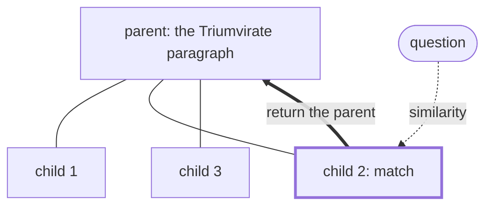

# Parent-document retrieval

## TL;DR
Index **small** child chunks (precise matching), but when one matches, return its **large** parent (a section or a whole document) to the LLM (enough context). This decouples "the unit you search" from "the unit you read", which removes the main trade-off in [[Chunking strategies]].

## Intuition
"Small to big": a 100-token chunk saying "Crassus was killed at Carrhae in 53 BC" embeds sharply and matches the question well. But the answer to *"what happened to the alliance?"* needs the whole paragraph about the triumvirate collapsing. Match on the needle, hand over the haystack section.

**Auto-merging** (LlamaIndex) is a variant: if many children of the same parent are retrieved, replace them with the parent.

## Formulation
Parent map $\pi:\text{child}\to\text{parent}$. Retrieve children $\mathcal C_K(q)$ by similarity, then

$$
\mathcal P(q)=\text{dedup}\big(\{\pi(c):c\in\mathcal C_K(q)\}\big)\ \text{in order of best child score},\quad\text{truncate to token budget}
$$

Auto-merge rule: replace children of parent $p$ with $p$ itself if $\frac{|\{c\in\mathcal C_K(q):\pi(c)=p\}|}{|\text{children}(p)|}\ge\theta$ (e.g. $\theta=0.5$).

## Algorithm
1. Ingest: split into parents (sections or ~2000 tokens), split each parent into children (~200 tokens), embed **children only**, store the $\pi$ mapping and parent texts in a docstore.
2. Query: retrieve top-$K$ children → map to parents → dedupe → fill the budget.

## Pros / cons
| Pros vs. [[Naive RAG]] | Cons |
|---|---|
| Precise matching *and* sufficient context | More tokens per answer (cost, distraction) |
| No LLM cost at ingest | Parents can blow the context budget; cap $K$ |
| Easy to add | Parent boundaries still matter |

## When to use
Manuals, contracts, policies: wherever the answer is a section, not a sentence. Anti-pattern: tight context budgets with many hits.

## Combines with
[[Hybrid search]] over children, [[Cross-encoder reranking]] over children (or parents), [[Contextual retrieval]] on children.

## Implementation notes
Not implemented yet. LangChain `ParentDocumentRetriever`, LlamaIndex `AutoMergingRetriever`. In this repo, the natural "parent" is a paragraph (the sample docs are paragraph-structured), with children = sentences.

## Results
No implementation yet.

## References
- LangChain docs: ParentDocumentRetriever. https://python.langchain.com/docs/how_to/parent_document_retriever/
- LlamaIndex docs: Auto-Merging Retriever.
