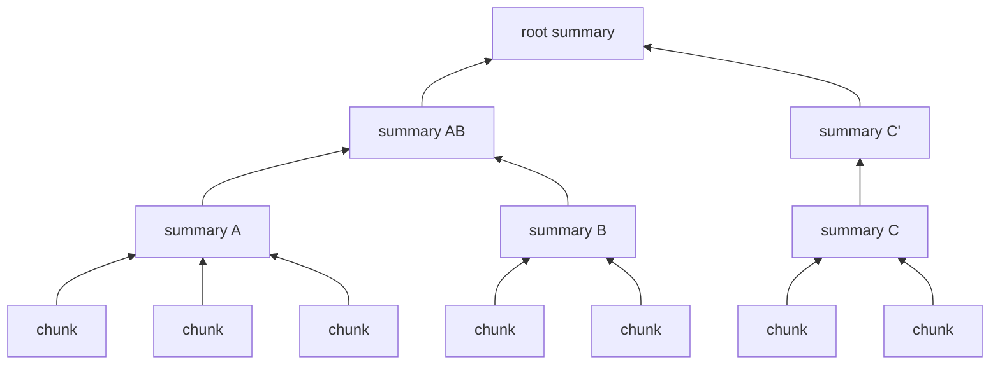

# RAPTOR

## TL;DR
Build a tree **bottom-up**. Embed the chunks, cluster similar ones, have an LLM summarize each cluster, then embed, cluster and summarize the summaries, and repeat until one or a few root summaries remain. At query time, search over **all levels at once**. Leaf chunks answer detail questions and high-level summaries answer big-picture ones. Ingest is expensive and incremental updates are hard.

## Intuition
[[Naive RAG]] can only return passages that exist. "What is this corpus about?" has no single passage answer. RAPTOR *manufactures* passages at every level of abstraction, so the answer exists somewhere in the index. It's like [[GraphRAG]]'s community reports, but clustered by embedding similarity rather than by an extracted entity graph, and it needs no entity extraction.

## Formulation
**Soft clustering with a Gaussian Mixture Model** on (UMAP-reduced) embeddings $\mathbf x$:

$$
p(\mathbf x)=\sum_{c=1}^{C}\pi_c\,\mathcal N(\mathbf x\mid\boldsymbol\mu_c,\boldsymbol\Sigma_c)
$$

A chunk joins every cluster with posterior $p(c\mid\mathbf x)>$ threshold, so one chunk can feed several summaries (soft assignment).

**Choosing the number of clusters $C$** by the Bayesian Information Criterion:

$$
\text{BIC}=\ln(N)\,p-2\ln\hat L
$$

- $N$: points; $p$: number of model parameters; $\hat L$: maximized likelihood. Pick the $C$ with the lowest BIC (fit vs. complexity).
- UMAP first reduces the dims, because GMMs behave poorly in 1000+-d.

**Retrieval, collapsed tree (the better variant in the paper):** put *all* nodes (leaves + summaries) in one pool and take nodes by cosine similarity until a token budget is filled. **Tree traversal:** start at the root, pick top-$k$ children at each level, descend.

## Algorithm
**Ingest**
1. Chunk (~100 tokens in the paper), embed.
2. Repeat until too few nodes to cluster: UMAP → GMM (BIC for $C$) → LLM summarizes each cluster → embed the summaries → they become the next level.

**Query:** collapsed-tree similarity search over all nodes, fill the budget, generate.

## Pros / cons
| Pros vs. [[Naive RAG]] | Cons |
|---|---|
| Answers both detail and big-picture questions | Many LLM calls at ingest |
| Query time is still plain vector search (cheap) | Summaries lose facts or hallucinate; errors compound up the tree |
| No entity schema (unlike [[GraphRAG]]) | Hard to update incrementally (re-cluster) |
| | Clustering hyperparameters (UMAP, thresholds) |

## When to use
Books, long reports, and multi-document corpora where questions range from "what page number…" to "what's the overall argument…". Anti-pattern: corpora that change daily.

## Combines with
[[Hybrid search]] over the node pool, [[Cross-encoder reranking]] of mixed-level nodes. Contrast with [[GraphRAG]] (entity-graph communities, map-reduce global search) and [[Vectorless RAG]] (top-down LLM-authored ToC, navigated by reasoning).

## Implementation notes
Not implemented yet. Reference implementation: github.com/parthsarthi03/raptor; LlamaIndex has a RAPTOR pack. For this repo: `umap-learn` + `sklearn.mixture.GaussianMixture`, summaries with `gemini-2.5-flash`. The 27-chunk corpus would yield only a 2–3-level tree, which is fine for learning, since you can inspect every summary.

## Results
No implementation yet.

## References
- Sarthi et al. (2024). *RAPTOR.* ICLR. https://arxiv.org/abs/2401.18059. The authors report state-of-the-art results at the time on QuALITY when RAPTOR was paired with GPT-4.
