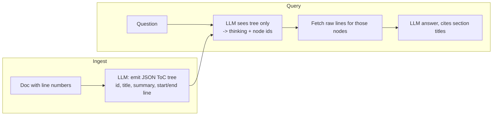

# Vectorless RAG

## TL;DR
No embeddings and no vector DB. At ingest, an LLM reads each document and writes a **hierarchical table of contents** (node id, title, summary, line range). At query time, the LLM is shown only that compact tree, *reasons* about which sections hold the answer, and returns node ids. The raw text of those sections then feeds the answer call. It works well for long, well-structured documents (reports, manuals, filings) where a human would navigate by the ToC. It doesn't scale to huge corpora because the whole tree must fit in a prompt.

## Intuition
How does a person find something in a 300-page annual report? They don't compute cosine similarity; they read the table of contents, think "revenue by segment will be in MD&A → Segment results", and jump there. Vectorless RAG replaces *similarity* with *reasoning over structure*. That helps when the relevant section doesn't share vocabulary with the question ("how did they do in Asia?" → "Segment results: APAC"), and when the answer needs a whole coherent section rather than a 600-char fragment.



## Formulation
There is no learned similarity function. Retrieval is a policy $\pi_\text{LLM}$ over a tree $\mathcal T$:

$$
S = \pi_\text{LLM}\big(q,\ \text{view}(\mathcal T)\big)\subseteq \text{nodes}(\mathcal T),\qquad |S|\le m
$$

$$
\text{context}(S)=\bigoplus_{n\in S}\text{lines}\big[\text{start}_n,\ \text{end}_n\big]
$$

- $\text{view}(\mathcal T)$: the tree with ids, titles and summaries only (no raw text). This keeps the retrieval prompt small.
- $m$: `max_nodes` (5 here). $\oplus$: concatenation.
- Tree invariants requested from the indexer: every line belongs to exactly one leaf, and sibling ranges are contiguous and non-overlapping. The ranges are inclusive and 1-indexed.

**Cost model.** Retrieval prompt tokens grow with $\sum_{n\in\mathcal T}|\text{title}_n|+|\text{summary}_n|$. That is linear in corpus size, which is the scaling limit. Real systems navigate the tree level by level (an agentic tree search) instead of showing all of it at once.

## Algorithm
**Ingest** (one LLM call per document)
1. Prefix every line with its number; ask the LLM for a 2–3 level JSON tree covering all lines.
2. Prefix node ids with a document tag (`d0_001.2`) so they're unique across documents.
3. Save tree + raw lines (`output/vectorless_index.json`).

**Query** (two LLM calls)
1. Retrieval call: question + compact tree → `{"thinking": ..., "node_list": [...]}`.
2. Look up each id; unknown ids are skipped with a warning (the LLM can invent ids).
3. Answer call: question + raw text of the selected sections; the model must cite section titles.

## Pros / cons
| Pros | Cons |
|---|---|
| No embedding model, no vector DB, no chunk-size tuning | Ingest quality depends entirely on the LLM's ToC (wrong line ranges = wrong text) |
| Retrieves coherent sections, not arbitrary windows | Whole tree in every retrieval prompt, which doesn't scale to large corpora |
| The `thinking` field makes the retrieval decision explainable | Two sequential LLM calls per query, so more latency than [[Naive RAG]] |
| Handles vocabulary mismatch through reasoning | Nondeterministic retrieval; hallucinated node ids |
| Natural fit for documents that already have structure | Weak for needle-in-haystack facts buried in an off-topic section |

## When to use
- Long, structured professional documents: financial filings, regulatory texts, technical manuals, legal contracts.
- When explainability of *why* a passage was retrieved matters.
- Anti-pattern: thousands of short, unstructured documents (tweets, tickets). The tree becomes a flat list and the prompt explodes.

## Combines with
- [[Agentic RAG]] / [[Iterative retrieval]]: navigate the tree level by level, reading more as needed.
- [[Parent-document retrieval]] shares the idea of "return the whole section".
- Compare: [[RAPTOR]] builds a summary tree *bottom-up* by clustering embeddings, and retrieves by similarity. This builds it *top-down* by an LLM, and retrieves by reasoning. [[GraphRAG]] builds an entity graph instead of a document tree.

## Implementation notes
Code: [vectorless_rag.py](../../../rag/vectorless_rag.py) (`VectorlessRAG`, `DocumentNode`), demo: [07_vectorless_rag_demo.py](../../../examples/07_vectorless_rag_demo.py). Offline tests: [test_vectorless.py](../../../tests/test_vectorless.py).

- Model: `gemini-2.5-flash` with **thinking disabled** (`thinking_budget=0`). With thinking on, the structured-JSON calls could spend their whole token budget thinking and return nothing.
- JSON parsing tolerates ```` ``` ```` fences (`rag/utils.py: parse_llm_json`).
- Token usage of the retrieval + answer calls is summed into `VectorlessResult.prompt_tokens` / `completion_tokens`.
- `max_nodes=5`. Retrieval prefers leaves but may return a parent, in which case the full parent range is used.
- Benchmark key: `vectorless`.

## Results
```dataview
TABLE dataset, answer_correctness, faithfulness, entity_coverage, context_entity_recall, latency_s_p50, commit
FROM "notes/results/vectorless-rag"
SORT run_id DESC
```
Static view: [[Leaderboard]].

## References
- VectifyAI, *PageIndex* (2025). https://github.com/VectifyAI/PageIndex. The "vectorless, reasoning-based RAG" design this implementation is modeled on.
- Related: Sarthi et al. (2024), *RAPTOR* (see [[RAPTOR]]); MemWalker, Chen et al. (2023), *Walking Down the Memory Maze: Beyond Context Limit through Interactive Reading.* https://arxiv.org/abs/2310.05029. An LLM navigates a summary tree.
