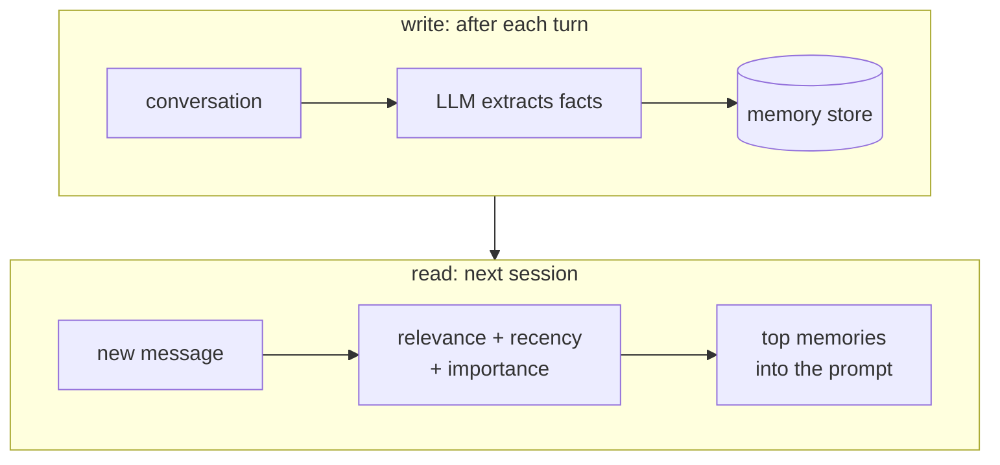

# Conversational memory RAG

## TL;DR
Treat the user's **own past interactions** (facts they told you, preferences, earlier conversations) as a retrievable corpus. Write salient memories during or after conversations, and retrieve the relevant ones into the prompt later. You get personalization and continuity across sessions. Privacy, stale memories and deciding what to remember are the hard parts.

## Intuition
Context windows end and sessions end. A tutor that forgets you struggled with integrals last week isn't much of a tutor. Memory RAG is RAG where the documents are written *by the conversation itself*. Two design questions dominate: **what to write** (raw transcripts are noisy; extracted facts are compact but lossy) and **what to retrieve** (relevant *and* recent *and* important).

## Formulation
Memory store $\mathcal M=\{m_i\}$ with text, embedding, timestamp $t_i$, importance $\iota_i$. Retrieval score (Generative Agents):

$$
\text{score}(m_i)=\alpha\,\text{rel}(q,m_i)+\beta\,\gamma^{\,t_\text{now}-t_i}+\eta\,\iota_i
$$

- $\text{rel}$: cosine similarity; $\gamma\in(0,1)$: recency decay per hour (paper: 0.995); $\iota$: LLM-rated importance (1–10, normalized).
- $\alpha,\beta,\eta$: weights (all 1 in the paper, after min-max normalizing each term).

**Write path:** after each turn or session, $\text{LLM}_\text{extract}(\text{turns})\to$ candidate memories, then **reconcile** with existing ones (add / update / delete / no-op). This prevents contradictory memories ("lives in Paris" vs "moved to Berlin").

## Algorithm
1. Short-term: recent turns stay in the prompt verbatim (or summarized).
2. Write: extract facts → dedupe/update against the store → embed → save.
3. Read: rewrite the current turn into a standalone query ([[Query rewriting]]) → score memories → top-$k$ into the system prompt.
4. Let the user see and delete memories.

## Pros / cons
| Pros | Cons |
|---|---|
| Personalization, continuity | Privacy, consent, retention policy |
| Small, user-specific corpus, so retrieval is easy | Stale or contradictory memories |
| | "What's worth remembering" is subjective |
| | Memory injection: wrong memories persist and compound |

## When to use
Personal assistants, tutors, coaching, customer relationships with long histories.

## Combines with
[[Query rewriting]] (contextualize follow-ups), [[Hybrid search]] over memories (names and dates matter). For a small, fixed profile, [[Cache-Augmented Generation]] (just put it in the system prompt) beats retrieval.

## Implementation notes
Not implemented yet. Libraries: mem0, Letta (MemGPT), LangGraph memory stores, Zep. The hard part is the reconcile step, not the vector store.

## Results
No implementation yet.

## References
- Packer et al. (2023). *MemGPT.* https://arxiv.org/abs/2310.08560
- Park et al. (2023). *Generative Agents.* https://arxiv.org/abs/2304.03442
