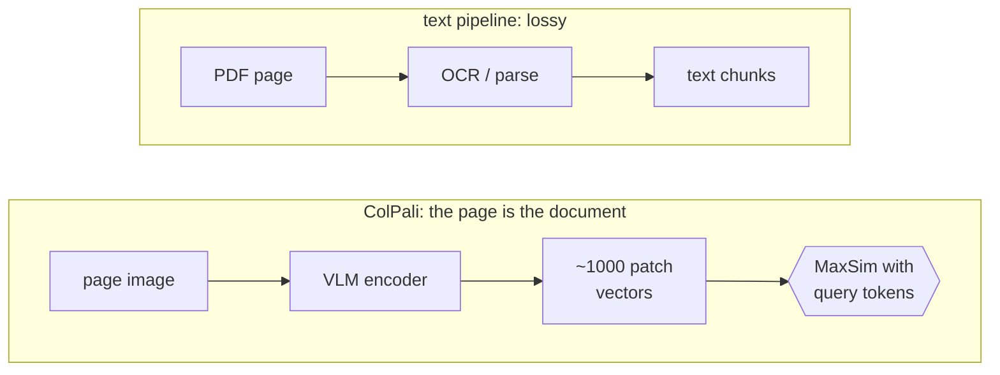

# Multimodal RAG

## TL;DR
Retrieve over **images of pages** (plus figures, tables, slides), not just extracted text, and generate with a vision-language model that reads the retrieved page images. **ColPali** embeds each page screenshot into many patch vectors and scores them with [[ColBERT]]-style MaxSim. It keeps the charts, layout and tables that text extraction destroys. Indexes are larger and generation costs more.

## Intuition
A financial report's key number is often in a bar chart; a slide's meaning is in its layout; a scanned contract has no text layer at all. The classic pipeline is OCR → text chunks → embed. It's lossy, brittle and slow. ColPali skips it: *the page image is the document*. A vision-language model (PaliGemma) turns the page into ~1000 patch embeddings, and each query token finds its best-matching patch, the same late-interaction trick [[ColBERT]] uses over text tokens.

## Formulation
Page image → VLM → patch embeddings $P\in\mathbb R^{n_p\times 128}$ ($n_p\approx1030$ for a 32×32 grid plus special tokens). Query → token embeddings $Q\in\mathbb R^{m\times128}$ (same model, text-only).

$$
S(q,\text{page})=\sum_{i=1}^{m}\max_{j=1}^{n_p}\ \mathbf q_i\cdot\mathbf p_j
$$

Storage per page ≈ $n_p\times128$ values; ~1000× a single-vector embedding before compression or token pooling.

**Three architectures** for multimodal RAG:
1. Text-only pipeline: OCR/captioning → text retrieval → text LLM.
2. Multimodal embeddings, one vector per page or image (CLIP-like, e.g. Voyage multimodal, Cohere Embed v4).
3. Late interaction over patches (ColPali/ColQwen) → VLM generation from page images.

## Algorithm
**Ingest:** render each PDF page to an image → VLM encoder → store patch vectors (multi-vector index).
**Query:** encode the question → MaxSim over pages (often after a cheaper first stage) → top-$k$ page images → VLM (Gemini, Claude, GPT-4o) answers from the images.

## Pros / cons
| Pros | Cons |
|---|---|
| Keeps charts, tables, layout, handwriting | Large multi-vector indexes |
| No OCR/parsing pipeline to maintain | Image tokens are expensive at generation |
| Strong on visually rich documents | Weaker for long pure-text pages vs text retrievers |
| Interpretable: patch-level similarity heatmaps | Less mature infra |

## When to use
Slide decks, scanned PDFs, financial and scientific reports with figures, forms, infographics.

## Combines with
[[ColBERT]] (same scoring idea), [[Text-to-SQL RAG]] (extract tables to SQL for exact figures), [[Hybrid search]] (text path for text-heavy pages).

## Implementation notes
Not implemented yet. `colpali-engine` (vidore models ColPali / ColQwen2), `byaldi` (RAGatouille-style wrapper). Gemini models accept images, so generation could reuse the existing client. Benchmark: ViDoRe.

## Results
No implementation yet.

## References
- Faysse et al. (2024). *ColPali.* https://arxiv.org/abs/2407.01449
