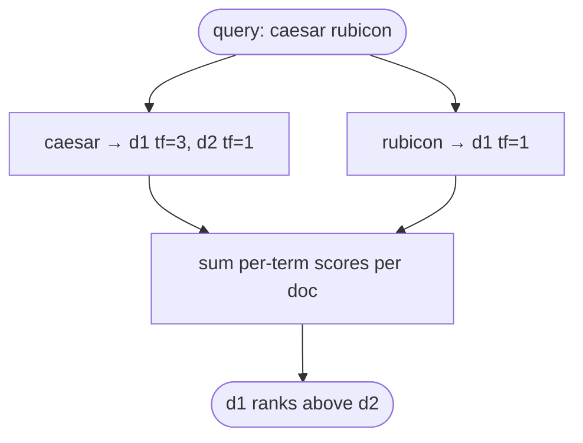

# BM25

## TL;DR
The classic keyword-ranking function behind Lucene, Elasticsearch and OpenSearch. A document scores high when it contains the query's terms, especially **rare** terms, with **diminishing returns** for repetition and a **penalty for length**. No training, interpretable, very fast via an inverted index. It excels at exact IDs, codes and rare names; it fails on synonyms and paraphrases. In RAG it's almost always used as one half of [[Hybrid search]].

## Intuition
Three ideas, each fixing a flaw of raw term counting:
1. **IDF:** "the" appears everywhere and says nothing, while "Rubicon" appears in one document and says a lot. So weight terms by rarity.
2. **Saturation ($k_1$):** a document mentioning "Caesar" 20 times isn't 20× more relevant than one mentioning it once. Term frequency is passed through a curve that flattens.
3. **Length normalization ($b$):** long documents contain more words by chance. Scale term frequency by how long the document is relative to average.

**Why "sparse":** conceptually each document is a vocabulary-sized vector (50k–1M+ dims), almost all zeros. In practice it's stored as an **inverted index** (term → posting list of (doc, tf)). Query time touches only the posting lists of the query's terms, so it's very fast.

## Formulation

$$
\text{score}(D,Q)=\sum_{i=1}^{n}\text{IDF}(q_i)\cdot\frac{f(q_i,D)\,(k_1+1)}{f(q_i,D)+k_1\left(1-b+b\,\frac{|D|}{\text{avgdl}}\right)}
$$

$$
\text{IDF}(q)=\ln\!\left(\frac{N-n(q)+0.5}{n(q)+0.5}+1\right)
$$

- $Q=\{q_1..q_n\}$: query terms. $f(q,D)$: frequency of term $q$ in document $D$.
- $N$: number of documents. $n(q)$: number of documents containing $q$.
- $|D|$: length of $D$ in tokens; avgdl: average document length.
- $k_1\approx1.2$–$2.0$: saturation. $k_1=0$ ignores tf entirely; $k_1\to\infty$ is raw tf.
- $b\approx0.75$: length normalization. $b=0$ means none; $b=1$ means full.
- The $+1$ inside the log (Lucene's variant) keeps IDF positive even for terms in over half the documents.

![[bm25_saturation-light.svg]]![[bm25_saturation-dark.svg]]
*Left: the tf component flattens as a term repeats; larger $k_1$ saturates later. Right: with $b>0$, the same 3 occurrences count for less in a longer-than-average document. Generated by `rag/viz/figures.py` (`bm25_saturation`).*

**Worked example.** $N=3$, query "caesar rubicon", $n(\text{caesar})=2$, $n(\text{rubicon})=1$; document $D$ has $|D|=\text{avgdl}$ (length factor $=1$), $f(\text{caesar})=3$, $f(\text{rubicon})=1$; $k_1=1.2$.

- $\text{IDF(caesar)}=\ln(1.5/2.5+1)=\ln 1.6=0.470$
- $\text{IDF(rubicon)}=\ln(2.5/1.5+1)=\ln 2.667=0.981$
- tf part, caesar: $\frac{3\cdot2.2}{3+1.2}=1.571$ (not 3× the single-occurrence value, which is saturation at work)
- tf part, rubicon: $\frac{1\cdot2.2}{1+1.2}=1.0$
- Score $=0.470\cdot1.571+0.981\cdot1.0=1.719$. The rare term contributes more despite appearing once.

## Algorithm
**Ingest:** tokenize (lowercase, maybe stem, drop stopwords), build the inverted index, store doc lengths and avgdl.
**Query:** tokenize the query the same way, walk the posting lists, accumulate scores, return the top-$k$ (WAND/BlockMax-WAND skip documents that can't make the top-$k$).

## Pros / cons
| | Sparse (BM25) | Dense ([[Dense retrieval]]) |
|---|---|---|
| Matching | Exact term overlap | Semantic similarity |
| Synonyms / paraphrase | No | Yes |
| Exact IDs, codes, rare names | Excellent | Often poor |
| Training needed | No | Yes; weaker out of domain |
| Interpretable | Yes (per-term contributions) | No |
| Index size / speed | Small / very fast | Larger / ANN needed |

The failure modes are complementary, which is why [[Hybrid search]] works.

## When to use
- Always as part of a hybrid. On its own: search over code, logs, part numbers, legal citations, product SKUs.
- Strong zero-shot baseline in new domains where dense models weren't trained (BEIR showed BM25 often beats early dense retrievers out of domain).
- Anti-pattern: conversational, paraphrased, or cross-lingual queries.

## Combines with
[[Hybrid search]] and [[Reciprocal Rank Fusion]] (fuse with dense), [[Cross-encoder reranking]] (BM25 top-100 → rerank), [[Contextual retrieval]] (index chunk + generated context for "contextual BM25"). [[SPLADE]] is the learned version.

## Implementation notes
Not implemented in this repo yet. Easiest path: `rank_bm25` (pure Python, fine for small corpora) or `bm25s` (fast, scipy-sparse); Elasticsearch/OpenSearch/Tantivy at scale. Tokenization choices (stemming, stopwords) matter as much as $k_1,b$. A natural first experiment: a BM25 retriever over the same `TextChunker` chunks, fused with the existing dense scores.

## Results
No implementation yet.

## References
- Robertson & Zaragoza (2009). *The Probabilistic Relevance Framework: BM25 and Beyond.*
- Thakur et al. (2021). *BEIR: A Heterogeneous Benchmark for Zero-shot Evaluation of IR Models.* https://arxiv.org/abs/2104.08663
