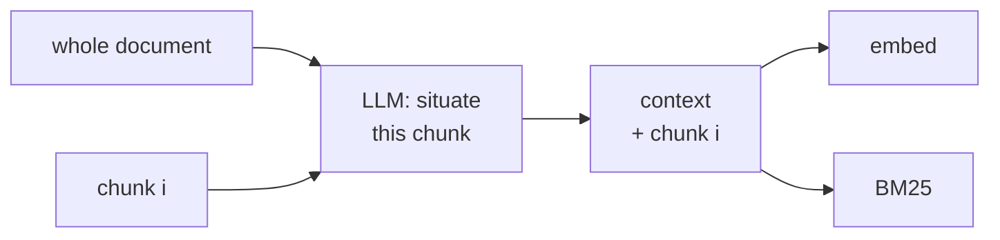

# Contextual retrieval

## TL;DR
At ingest, for every chunk, ask an LLM: *"Here is the whole document; here is one chunk. Write 1–2 sentences situating this chunk in the document."* Prepend that context to the chunk **before** embedding it and before BM25-indexing it. Chunks stop being "orphaned" fragments, and retrieval recall goes up substantially. All the cost is paid once, at ingest (and prompt caching makes it cheap). Nothing changes at query time.

## Intuition
A chunk that reads *"Revenue grew 3% over the previous quarter"* is unretrievable for "ACME Q2 2023 revenue growth": it names neither the company nor the quarter. Those facts are in the document's title or a heading three pages earlier. The fix is to put them back into the chunk text: *"This chunk is from ACME's Q2 2023 10-Q, section on revenue. Revenue grew 3%…"*. Both embeddings and BM25 now see "ACME" and "Q2 2023".

In this repo's corpus: a chunk starting *"After defeating Pompey at the Battle of Pharsalus…, Caesar became master…"* is fine, but a chunk starting mid-sentence *"…they stabbed Caesar 23 times"* loses "Brutus" and "Ides of March", which sit in the previous window.

> [!example] Before / after (chunk from this repo's corpus)
> **Before:** "…they stabbed Caesar 23 times in the Theatre of Pompey. Caesar's death plunged Rome into another round of civil wars."
> **After:** "*From a history of the late Roman Republic; describes Caesar's assassination by Brutus and Cassius on the Ides of March, 44 BC.* …they stabbed Caesar 23 times…"

## Formulation
For document $D$ with chunks $c_1..c_n$:

$$
\tilde c_i=\text{LLM}_\text{ctx}(D, c_i)\ \Vert\ c_i,\qquad \mathbf e_i=f(\tilde c_i),\qquad \text{BM25 indexes }\tilde c_i
$$

- $\Vert$: concatenation; $\text{LLM}_\text{ctx}$ returns ~50–100 tokens.
- The generator can see either $c_i$ or $\tilde c_i$; both work.

**Cost with prompt caching.** Every call shares the prefix $D$. Cache $D$ once, and each chunk call pays full price only for $c_i$ + output. Ingest cost $\approx$ one full read of $D$ + $n\times$(cache-read of $D$ + small delta).

**Related: late chunking** (Günther et al.) gets context into chunk embeddings *without an LLM*. Embed the whole document with a long-context embedder, then mean-pool token vectors per chunk span. Each chunk vector is then conditioned on the full document.

## Algorithm
**Ingest:** chunk → for each chunk, LLM call with (document, chunk) → prepend context → embed + BM25-index the contextualized text.
**Query:** unchanged ([[Hybrid search]] + [[Cross-encoder reranking]] recommended).

## Pros / cons
| Pros vs. [[Naive RAG]] | Cons |
|---|---|
| Large recall gains; nothing changes at query time | One LLM call per chunk at ingest |
| Helps *both* dense and BM25 | Re-run when documents change |
| Simple to implement | Document must fit in the context window (else use section-level context) |
| | Generated context can be wrong (rare, but silent) |

## When to use
Long reports, filings, manuals, and papers, where chunks depend on headings and earlier sections. A high-ROI first upgrade after hybrid + rerank (the "Chunks lose their context?" box in [[RAG map]]).

## Combines with
[[Hybrid search]] (contextual BM25 + contextual embeddings), [[Cross-encoder reranking]], [[Parent-document retrieval]] (different fix for the same problem; they stack).

## Implementation notes
Not implemented yet. In this repo: subclass `StandardRAG`, override `index_directory` to contextualize each chunk with one `gemini-2.5-flash` call (thinking off), and save to a separate index dir. The corpus is tiny (3 docs, 27 chunks), so cost is negligible.

## Results
No implementation yet.

## References
- Anthropic (Sept 2024). *Introducing Contextual Retrieval.* https://www.anthropic.com/news/contextual-retrieval. Anthropic reports that contextual embeddings + contextual BM25 roughly halved top-20 retrieval failures on their evals, with further reductions when a reranker was added.
- Günther et al. (2024). *Late Chunking.* https://arxiv.org/abs/2409.04701
