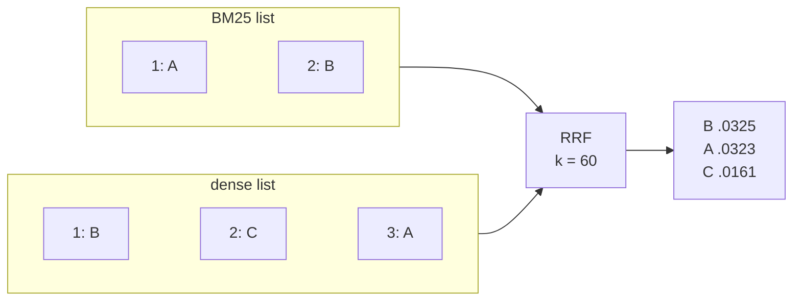

# Reciprocal Rank Fusion

## TL;DR
A one-line formula for merging several ranked lists: each list gives a document $1/(k+\text{rank})$ points, and you sum them. It uses only **ranks**, never raw scores, so it merges retrievers whose scores live on incomparable scales (BM25 vs cosine). It's the default glue for [[Hybrid search]] and [[Multi-query RAG-Fusion]].

## Intuition
A document that is *consistently* near the top across lists beats one that is #1 in a single list and absent elsewhere. The constant $k$ damps the advantage of rank 1 over rank 2. Without it, $1/1$ vs $1/2$ would make one retriever's top hit dominate everything.

## Formulation

$$
\text{RRF}(d)=\sum_{r\in R}\frac{1}{k+\text{rank}_r(d)},\qquad k\approx 60
$$

- $R$: the set of ranked lists (retrievers or query variants); $\text{rank}_r(d)\in\{1,2,\dots\}$.
- Documents absent from list $r$ contribute 0 for that list.
- $k$: smoothing constant; 60 came from the original paper's experiments and is rarely tuned.

**Effect of $k$:** with $k=0$, ranks 1 and 2 score 1.0 vs 0.5 (2× gap); with $k=60$, they score 0.0164 vs 0.0161 (1.6% gap). Agreement across lists then matters far more than position within one list.

![[rrf_rank_weight-light.svg]]![[rrf_rank_weight-dark.svg]]
*With $k=60$, rank 20 still keeps ~76% of rank 1's weight, so agreement across lists dominates. With $k=0$ the top rank dominates. Generated by `rag/viz/figures.py` (`rrf_rank_weight`).*

**Worked example:** see [[Hybrid search]] (B beats A because it is near the top in both lists).

Weighted variant: $\sum_r w_r/(k+\text{rank}_r(d))$ to trust one retriever more.

## Algorithm
1. Get top-$K$ lists from each retriever.
2. For each unique document, sum $1/(k+\text{rank})$ across lists.
3. Sort by fused score.

## Pros / cons
| Pros | Cons |
|---|---|
| No score normalization or training | Throws away score magnitudes / confidence |
| Robust; hard to beat in practice | $K$ (list depth) affects results |
| Trivial to implement | Can't express "retriever A is much better", except via weights |

## When to use
Any time you have two or more rankings: hybrid search, multi-query, multiple indexes, multiple embedding models.

## Combines with
[[Hybrid search]], [[Multi-query RAG-Fusion]], then [[Cross-encoder reranking]] after fusion.

## Implementation notes
~10 lines of Python with a `defaultdict(float)`. Keep it in `rag/` as a pure function with a unit test, since it's a nice first piece of shared retrieval utility.

## Results
No implementation yet.

## References
- Cormack, Clarke & Büttcher (2009). SIGIR. https://dl.acm.org/doi/10.1145/1571941.1572114
