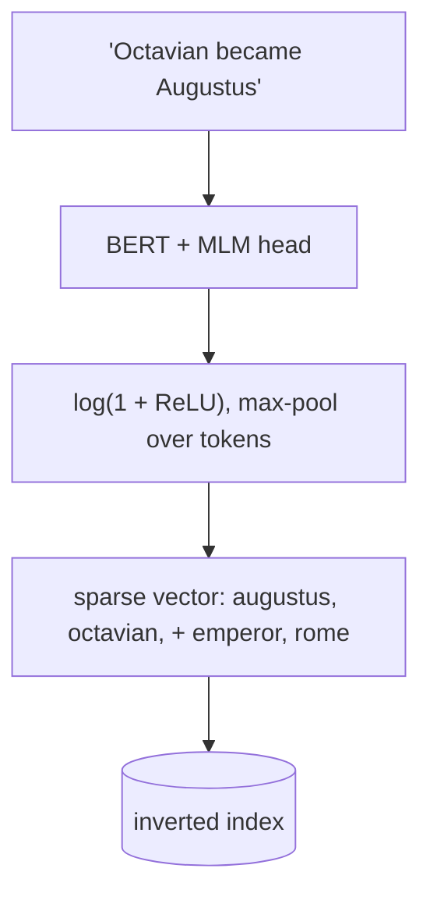

# SPLADE

## TL;DR
A transformer outputs a **sparse, vocabulary-sized** weight vector for each query and document, like [[BM25]], except the weights are *learned* and the model **expands** the text with related terms it doesn't literally contain ("car" also activates "vehicle", "automobile"). You get some semantic matching while keeping inverted-index efficiency and interpretability. It sits between [[BM25]] and [[Dense retrieval]].

## Intuition
BM25's weakness is vocabulary mismatch; dense retrieval's weakness is losing exact terms. SPLADE keeps the representation in "word space" (so exact terms survive and you can read the weights), but uses BERT's masked-language-model head to decide *which* words matter and *which related words to add*. A document about "Octavian becoming Augustus" might get nonzero weight on "emperor" and "rome", so it can match a query that uses those words.

*Expansion terms (emperor, rome) are illustrative: the model can add words the text never contains.*

## Formulation
Let $w_{ij}$ be the MLM logit for vocabulary term $j$ at input position $i$ (from BERT's MLM head). The representation of text $t$ is

$$
w_j=\max_{i\in t}\ \log\!\big(1+\mathrm{ReLU}(w_{ij})\big),\qquad j=1..|V|
$$

(SPLADE v1 sums over positions; v2 uses max pooling.) $\log(1+\mathrm{ReLU}(\cdot))$ keeps weights non-negative and dampens large ones, analogous to [[BM25]]'s tf saturation.

Scoring is a sparse dot product: $s(q,d)=\sum_{j\in V} w_j^{(q)}\,w_j^{(d)}$.

**Sparsity regularization (FLOPS).** Without it every term gets a little weight and the index is dense. With batch size $N$:

$$
\ell_\text{FLOPS}=\sum_{j\in V}\Big(\frac1N\sum_{i=1}^{N}w_j^{(d_i)}\Big)^2,\qquad
\mathcal L=\mathcal L_\text{rank}+\lambda_q\ell^{q}_\text{FLOPS}+\lambda_d\ell^{d}_\text{FLOPS}
$$

It penalizes terms that are active across many documents, which mirrors IDF. $\lambda_q,\lambda_d$ trade effectiveness for posting-list length (= query speed).

## Algorithm
Ingest: run the encoder on every document, keep the nonzero term weights, write them to an inverted index. Query: encode the query (or, in "doc-only" variants, use plain tokens), traverse posting lists, sum weights.

## Pros / cons
| Pros | Cons |
|---|---|
| Handles vocabulary mismatch via expansion | Needs a GPU-ish encoder at ingest (and at query for full SPLADE) |
| Inverted index: fast, mature infra (Lucene etc.) | Longer posting lists than BM25, so slower than BM25 |
| Interpretable term weights | English-centric checkpoints; domain shift |
| Strong zero-shot results on BEIR | Less tooling than dense vectors |

## When to use
When you want hybrid-like quality from a single sparse index, or when your stack is Lucene/OpenSearch-based. Also as the sparse half of a hybrid in place of BM25.

## Combines with
[[Hybrid search]] (SPLADE + dense), [[Cross-encoder reranking]].

## Implementation notes
Not implemented yet. Checkpoints: `naver/splade-cocondenser-ensembledistil`, `naver/splade-v3`. Elasticsearch's ELSER and OpenSearch's neural sparse search are productized learned-sparse models.

## Results
No implementation yet.

## References
- Formal, Piwowarski & Clinchant (2021). *SPLADE.* https://arxiv.org/abs/2107.05720
- Formal et al. (2021). *SPLADE v2.* https://arxiv.org/abs/2109.10086
- Paria et al. (2020). *Minimizing FLOPs to Learn Efficient Sparse Representations.* https://arxiv.org/abs/2004.05665
